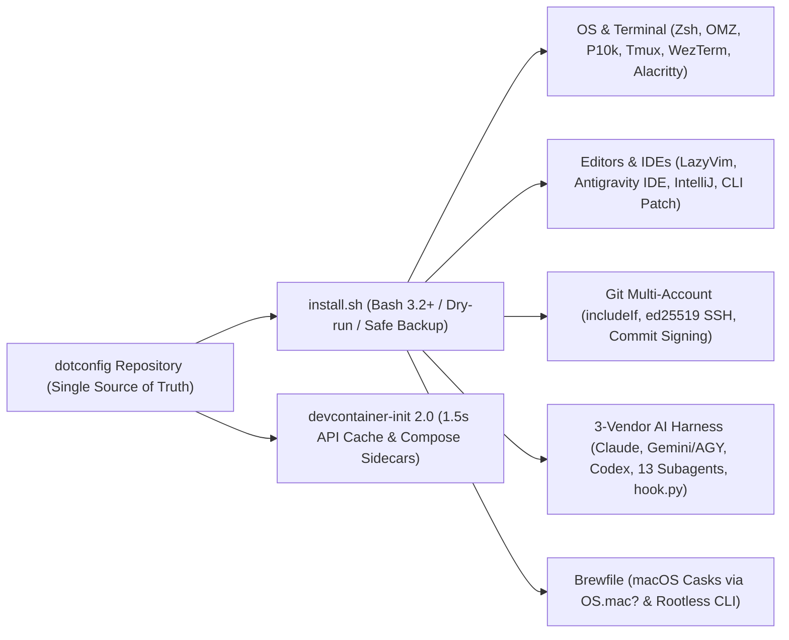

<div align="center">

# Dotconfig

**Cross-Platform, Zero-Sudo Developer Environment, Multi-Vendor AI Agent Harness & Dynamic Dev Container 2.0**

[-blue?style=flat-square)](./install.sh)
[](./zsh/.zshrc)
[](./nvim)
[](./agents)
[](./devcontainers)
[](./LICENSE)

[한국어](./README.md) | **English**

[Quick Start](#quick-start) · [Architecture](#architecture--symlink-mapping) · [AI Agent Harness](#1-ai-agent-lifecycle-hooks--13-subagents) · [Dev Container 2.0](#3-dev-container-20-generator-devcontainer-init) · [Engineering Fixes](#4-practical-troubleshooting--environment-automation) · [Deep-Dive Docs](./docs/ARCHITECTURE.md)

</div>

---

## Overview

**Dotconfig** is a declarative **Single Source of Truth (SSOT)** workspace repository built to keep development environments consistent across **macOS** and **Ubuntu/Linux (including rootless / non-sudo cluster hosts)**.

Rather than stopping at static dotfiles, it ties together a **3-vendor AI Agent Harness** (`Claude Code`, `Google Antigravity / Gemini CLI`, `OpenAI Codex`), **ephemeral Docker-based formatting**, **multi-account Git/SSH isolation**, and a **dynamic Dev Container 2.0 CLI generator** inside one idempotent Bash 3.2+ orchestrator.

### Design Principles

* **Zero-Sudo Cross-Platform Bootstrap**: Self-bootstraps Homebrew on macOS and rootless Linuxbrew (`~/.linuxbrew`) on Ubuntu, while automatically relocating IDE extensions, `~/.linuxbrew`, and `~/.cache/Homebrew` into `~/goinfre` on quota-limited workstations.
* **Single Source of Truth (SSOT)**: Shared engineering rules, **13 specialized subagents**, and lifecycle hooks live under `agents/shared/` and sync across Claude, Gemini/Antigravity, and Codex via `install.sh agents`.
* **Thin Host, Ephemeral Tooling**: Language toolchains run inside 9 Dev Container templates, and multi-language code formatting runs inside ephemeral Docker containers (`dotconfig-formatter`) rather than polluting the host OS.
* **Safety-First & Idempotent Execution**: Every installation supports `--dry-run`, relocates collisions into timestamped backups (`~/.dotconfig_backups/backup_YYYYMMDD_HHMMSS/`), and prevents secret leakage via `.gitignore` and PreToolUse guards.

---

## System Architecture



> For C4 diagrams, sequence flows, and **Architecture Decision Records (ADR)**, see [docs/ARCHITECTURE.md](./docs/ARCHITECTURE.md) (English) or [docs/ARCHITECTURE.ko.md](./docs/ARCHITECTURE.ko.md) (Korean).

---

## Quick Start

### Web One-Line Bootstrap (Fresh OS)

Run a single command on a clean machine to verify prerequisites, clone the repository to `~/.dotconfig`, and link all modules:

* Full automated setup (packages, symlinks, fonts, IDE extensions)

  ```bash
  /bin/bash -c "$(curl -fsSL https://raw.githubusercontent.com/gdtknight/dotconfig/main/install.sh)"
  ```

* Preview actions without modifying files

  ```bash
  /bin/bash -c "$(curl -fsSL https://raw.githubusercontent.com/gdtknight/dotconfig/main/install.sh)" -- --dry-run
  ```

* Install specific modules only (e.g., Neovim and Git)

  ```bash
  /bin/bash -c "$(curl -fsSL https://raw.githubusercontent.com/gdtknight/dotconfig/main/install.sh)" -- nvim git
  ```

> **Tip**: Override the default clone path (`~/.dotconfig`) by setting `DOTCONFIG_DIR=~/my/path` before running the command.

### Local Repository Execution

Inside an already-cloned repository, run `./install.sh` selectively (**no `sudo` required**):

> Use `-f` or `--force` to replace existing non-symlink targets after backing them up.

* Preview all symlinks and actions

  ```bash
  ./install.sh --dry-run all
  ```

* Apply full environment setup

  ```bash
  ./install.sh all
  ```

* Bootstrap Homebrew/Linuxbrew & sync Brewfile

  ```bash
  ./install.sh packages
  ```

* Install & register Nerd Fonts (D2Coding, ComicShannsMono) for macOS & Linux

  ```bash
  ./install.sh fonts
  ```

* Link global Git config & interactive multi-account setup

  ```bash
  ./install.sh git
  ```

* Link Zsh, Oh My Zsh, Powerlevel10k & plugins

  ```bash
  ./install.sh zsh
  ```

* Link `~/.tmux.conf`, install TPM & sync 9 Tmux plugins

  ```bash
  ./install.sh tmux
  ```

* Select & configure terminal emulator (Alacritty [default] / WezTerm / skip, auto-cleans unselected symlink, supports `-f` or `--terminal`)

  ```bash
  ./install.sh terminal
  ```

* Link LazyVim v14+ configuration

  ```bash
  ./install.sh nvim
  ```

* Link IDE settings, sync extensions & patch Docker v29+ CLI

  ```bash
  ./install.sh ide
  ```

* Sync Claude, Gemini/AGY, Codex configs, skills & CLIs

  ```bash
  ./install.sh agents
  ```

* Build `dotconfig-formatter` Docker image

  ```bash
  ./install.sh formatter
  ```

* Export current Antigravity IDE extensions to `extensions.txt`

  ```bash
  ./install.sh --dump-extensions
  ```

---

## Architecture & Symlink Mapping

```text
dotconfig/
├── install.sh                    # Cross-platform symlink installer, web bootstrapper & CLI patcher
├── Brewfile                      # Curated CLI & macOS-only Cask manifest (OS.mac? guarded)
├── README.md / README.en.md      # Main portfolio documentation (Korean / English)
├── CLAUDE.md / CLAUDE.ko.md      # Repository maintenance & agent guidelines (AGENTS.md -> CLAUDE.md)
├── docs/                         # Deep-dive system architecture & ADRs (English / Korean)
├── nvim/                         # LazyVim v14+, Obsidian dynamic vault scan, devcontainer.nvim
├── zsh/                          # Zsh (.zshrc, .zprofile, .p10k.zsh) & devcontainer-init wrapper
├── git/                          # Global .gitconfig (SSH signing, histogram diff) & .gitignore
├── agents/                       # Multi-vendor AI Agent harness (Claude, Gemini/AGY, Codex)
│   ├── shared/                   # SSOT: INSTRUCTIONS.md, rules/, 13 specialized agents/, skills/, mcp.json, sync_mcp.py, hook.py
│   ├── claude/                   # settings.json (Claude Code hook bindings)
│   ├── gemini/                   # settings.json, config.json, hooks.json, mcp_config.json (Graphify MCP)
│   └── codex/                    # config.toml & 13 TOML subagent wrappers
├── ide/                          # Antigravity IDE / VS Code (18 extensions) & IntelliJ IDEA
├── alacritty/                    # Alacritty terminal config & themes
├── wezterm/                      # WezTerm Lua configuration
├── tmux/                         # Tmux config with TPM auto-install & vim-tmux-navigator
├── devcontainers/                # 9 templates + Python-based Dev Container 2.0 generator engine
└── docker/formatter/             # Multi-language ephemeral code formatter Docker image
```

### Detailed Mapping Table

| Module | Repository Source | macOS Target (`$HOME`) | Ubuntu/Linux Target (`$HOME`) | Mechanism |
| :--- | :--- | :--- | :--- | :--- |
| **Neovim** | `nvim` | `~/.config/nvim` | `~/.config/nvim` | Directory symlink (LazyVim v14+, 9 custom plugins) |
| **Zsh** | `zsh/{.zshrc,.zprofile,.p10k.zsh}` | `~/.zshrc`, `~/.zprofile`, `~/.p10k.zsh` | Same as macOS | File symlinks + auto Oh My Zsh, P10k & plugin bootstrap |
| **Git** | `git/{.gitconfig,.gitignore}` | `~/.gitconfig`, `~/.gitignore`, `~/Projects/<account>/` | Same as macOS | File symlinks + `includeIf` multi-account SSH & signing |
| **Claude** | `agents/shared/*`, `agents/claude/settings.json` | `~/.claude/{CLAUDE.md,rules,agents,skills/*,hooks,settings.json}` | Same as macOS | Shared markdown, skills & hook symlinks + CLI auto-install |
| **Gemini / AGY** | `agents/shared/*`, `agents/gemini/*` | `~/.gemini/{GEMINI.md,agents}`, `~/.gemini/config/{rules,hooks,mcp_config.json,skills/*}` | Same as macOS | Shared rules/skills/MCP symlinks + `agy` CLI auto-install |
| **Codex** | `agents/shared/*`, `agents/codex/*` | `~/.codex/{AGENTS.md,config.toml,rules,agents,hooks,skills/*/SKILL.md}` | Same as macOS | Shared rules/skills & TOML wrapper links + CLI auto-install |
| **IDE (AGY / Code)** | `ide/antigravity-ide/*` | `~/Library/Application Support/Antigravity IDE/User/*` | `~/.config/Code/User/*` (`~/goinfre` extension isolation) | Settings symlinks, 18-extension sync & Docker v29+ patch |
| **IntelliJ IDEA** | `ide/intellij/*` | `~/Library/Application Support/JetBrains/IntelliJIdea*/*` | `~/.config/JetBrains/IntelliJIdea*/*` | Keymap (`macOS.xml`), VM options & properties links |
| **Tmux** | `tmux/tmux.conf` | `~/.tmux.conf` | Same as macOS | File symlink + auto TPM & 9 Tmux plugins sync |
| **Terminal & Fonts** | `alacritty`, `wezterm/wezterm.lua` | `~/.config/alacritty` or `~/.wezterm.lua` *(exclusive choice)*, `~/Library/Fonts` | Same + `~/.config/wezterm/wezterm.lua`, `~/.local/share/fonts` | Alacritty (default) / WezTerm selective symlink (auto-cleans unselected) + Step 1 Nerd Fonts & CoreText registration |

---

## Core Engineering Highlights

### 1. AI Agent Lifecycle Hooks & 13 Subagents

[`agents/shared/hooks/hook.py`](./agents/shared/hooks/hook.py) normalizes payloads (`toolCall` vs. `tool_name` / `tool_input`) across Claude Code, Gemini/Antigravity, and Codex into a single enforcement pipeline:

| Hook Event | Capability & Behavior |
| :--- | :--- |
| **`PreToolUse`** | • **Destructive Command Guard**: Token-aware parsers (`is_dangerous_rm`, `is_dangerous_chmod`) block root (`/`), home (`~`, `$HOME`), and critical system directories while safely permitting subpath cleanup (e.g., `/tmp/...`). Blocks `git push --force`, `git reset --hard`, `git clean -f`, `git checkout . / -f`, `mkfs`, `dd`.<br>• **Secret & Token Leak Prevention**: Blocks direct access to `.env` and key/credential files (allowing `.example`/`.sample`/`.template`), and detects GitHub (`ghp_`, `github_pat_`), OpenAI (`sk-`), Google (`AIzaSy`), AWS (`AKIA`), and Slack (`xox*`) token patterns. |
| **`PostToolUse`** | • **Ephemeral Container Formatting**: Formats modified files via `dotconfig-formatter:latest` (`prettier`, `ruff`, `google-java-format` v1.24.0, `clang-format`, `stylua`), excluding `.excalidraw.md`/`.excalidraw` to protect `%%...%%` blocks, with fallback to local binaries when Docker is unavailable. |
| **`Stop`** | • **Context-Aware Window Activation**: Sends macOS native notifications via `terminal-notifier` (`-activate`) and dynamically detects the originating app (`Antigravity IDE`, `WezTerm`, `Alacritty`, `iTerm2`, `Terminal`) so clicking the alert focuses the active workspace window instead of Script Editor. |

All three tools also share **13 specialized subagents** in [`agents/shared/agents/`](./agents/shared/agents):

* **Review & Quality**: `@code-reviewer` (OWASP/STRIDE/Fowler/SonarQube + parallel delegation), `@security-reviewer`, `@quality-reviewer`
* **Testing, Debugging & Refactoring**: `@test-agent`, `@unit-test-agent`, `@integration-test-agent`, `@debug-agent` (3-round hypothesis escalation), `@refactor-agent` (Baby Steps with `hook.py`-safe file restore)
* **Docs & Git Workflow**: `@commit-agent` (GitHub Flow & issue linking), `@github-agent` (GitHub Flow, CI merge & `--body-file -`), `@docs-agent`, `@guide-writer` (C4, ADR & Excalidraw), `@human-writer` (Anti-AI-ism & concise style presets)
* **Workload-Based 3-Vendor Model Tiering**: Assigns deep reasoning tasks (8 subagents) and fast execution/Git/docs tasks (5 subagents) across Claude (`opus`/`sonnet`), Codex (`model_reasoning_effort` `high`/`medium`), and Antigravity (`pro`/`flash` delegation tiers in `INSTRUCTIONS.md`).
* **Shared Skills & Cross-Vendor MCP Sync**: Multi-file skills including [`agents/shared/skills/graphify`](./agents/shared/skills/graphify) and [`agents/shared/skills/llm-wiki`](./agents/shared/skills/llm-wiki), alongside declarative servers in [`agents/shared/mcp.json`](./agents/shared/mcp.json), are converted and synced by [`sync_mcp.py`](./agents/shared/sync_mcp.py) across Claude (`~/.claude.json` merge), Gemini/AGY (`serverUrl`), and Codex (TOML `[mcp_servers.*]`).

### 2. Multi-Account Git & SSH Isolation

Manage separate work/school and personal GitHub identities on one machine without rewriting repository remote URLs:

```text
~/Projects/
├── <account1>/      # Uses ~/.gitconfig-<account1> (dedicated id_ed25519_<account1> + SSH signingkey)
└── <account2>/      # Uses ~/.gitconfig-<account2> (dedicated id_ed25519_<account2> + SSH signingkey)
```

* [`git/.gitconfig`](./git/.gitconfig) declares only shared defaults (`histogram` diff, `rebase.autoStash`, `gpg.format = ssh`, `commit.gpgsign = true`), keeping personal account metadata outside Git in `~/.config/dotconfig/git-accounts.env` and `~/.gitconfig.local`.
* `sshCommand` stays strictly scoped inside per-account configs so unrelated `~/.ssh/config` hosts remain untouched.

### 3. Dev Container 2.0 Generator (`devcontainer-init`)

[`devcontainers/`](./devcontainers) includes **9 stack templates** (`42-c-valgrind`, `devops-cloud`, `fullstack-db`, `go-backend`, `java`, `node-ts`, `python-ai`, `react-native`, `rust`) backed by a standard-library-only Python 3 CLI integrated with Zsh tab completion (`_devcontainer_init_completion`):

* **Bounded Smart Version Cache ([`version_fetcher.py`](./devcontainers/scripts/version_fetcher.py))**: Queries official APIs (`nodejs.org`, `endoflife.date`, `go.dev`) with a strict `1.5s` timeout (`TIMEOUT_SECONDS = 1.5`) and caches results in `~/.cache/dotconfig/devcontainer-versions.json` with offline `DEFAULT_FALLBACKS`.
* **Automatic Compose Elevation ([`db_templates.py`](./devcontainers/scripts/db_templates.py))**: Selecting any database sidecar (`postgres`, `redis`, `mysql`, `mongo`) upgrades single-container configs into a multi-service `docker-compose.yml` with persistent volumes.
* **Dual-Mode CLI & Neovim Mounting ([`init_devcontainer.py`](./devcontainers/scripts/init_devcontainer.py))**: Supports interactive prompts (`-i`) and scriptable flags (`-y`), plus `--nvim`/`--no-nvim`, `--docker-socket`, `--ai`, and `--no-install` (paired with `devcontainer.nvim` `<leader>D` keymaps on the host).

* Interactive wizard (fetches active SDK versions)

  ```bash
  devcontainer-init node-ts
  ```

* Scriptable one-liner (Node 22 + pnpm + Postgres/Redis sidecars + ports 3000, 8080)

  ```bash
  devcontainer-init node-ts --version 22 --pkg pnpm --db postgres,redis --port 3000,8080
  ```

* Python AI workspace (Python 3.12 + uv + port 8888 + bundled AI Agent CLIs)

  ```bash
  devcontainer-init python-ai --version 3.12 --pkg uv --port 8888 --ai
  ```

### 4. Practical Troubleshooting & Environment Automation

| Problem Encountered | Implemented Solution | Source |
| :--- | :--- | :--- |
| **Antigravity IDE Dev Containers hang on Docker v29+** | Built-in `devContainersSpecCLI.js` missed Docker's `i.Action` event field when checking `"start"===(i.status\|\|i.Status)`. `patch_antigravity_dev_containers()` patches this automatically during `install.sh ide`. | [install.sh](./install.sh#L507-L523) |
| **WhichKey Spacebar hijacks AI Chat & terminal input** | Isolated Vim Normal-mode `space -> whichkey.show` triggers behind `!antigravity.chatFocused && !inChat && !chatFocus && !chatInputHasFocus` context guards. | [keybindings.json](./ide/antigravity-ide/keybindings.json#L105-L125) |
| **Cluster NFS home quotas & Rootless Linux nodes** | Automatically relocates `.vscode/extensions`, `.antigravity-ide/extensions`, `~/.linuxbrew`, and `~/.cache/Homebrew` into `~/goinfre` while preserving internal symlinks/dotfiles, and gates macOS GUI casks inside `if OS.mac?`. | [install.sh](./install.sh) · [Brewfile](./Brewfile) |
| **SSH `EDITOR` override & Zsh init order** | `zsh/.zshrc` loads Homebrew `shellenv` *before* Oh My Zsh, prioritizes installed `nvim` as `EDITOR` even over `$SSH_CONNECTION`, and dynamically locates the repo via `_dotconfig_repo_dir()`. | [zsh/.zshrc](./zsh/.zshrc) |
| **Dynamic Obsidian Vault discovery + general Markdown fallback** | `obsidian.nvim` scans iCloud Obsidian folders alphabetically at startup and falls back to a CWD `no-vault` workspace for standalone Markdown files. | [obsidian.nvim.lua](./nvim/lua/plugins/obsidian.nvim.lua#L1-L42) |

---

## Documentation Index

| Document | 한국어 | English |
| :--- | :--- | :--- |
| **Main Manual & Mapping** | [README.md](./README.md) | [README.en.md](./README.en.md) |
| **Architecture & Decisions (ADR)** | [docs/ARCHITECTURE.ko.md](./docs/ARCHITECTURE.ko.md) | [docs/ARCHITECTURE.md](./docs/ARCHITECTURE.md) |
| **Agent & Contributor Guidelines** | [CLAUDE.ko.md](./CLAUDE.ko.md) | [CLAUDE.md](./CLAUDE.md) |
| **License** | [LICENSE](./LICENSE) (MIT) | [LICENSE](./LICENSE) (MIT) |

---

## License

Released under the [MIT License](./LICENSE).
