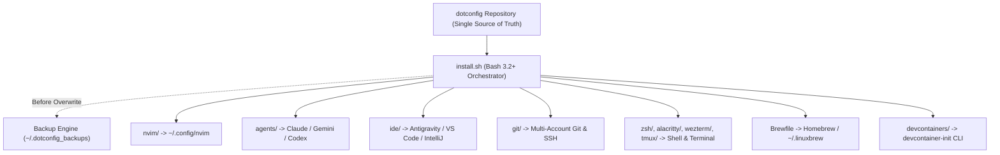

[English](./README.md) | **한국어**

# Dotconfig

[](#개요-overview)
[](#빠른-시작-quick-start)
[-57A143?style=flat-square&logo=neovim&logoColor=white)](#아키텍처-및-심볼릭-링크-매핑-architecture--symlink-mapping)
[](./LICENSE)

**macOS 및 Ubuntu Linux(Rootless 환경 포함)를 위한 선언적(Declarative) 중앙 개발 환경 관리 저장소**입니다.  
Neovim(LazyVim), 3사 LLM 코딩 에이전트(Claude Code, Gemini CLI, Codex), Antigravity IDE, Dev Container 2.0 생성기, 셸(Zsh/Tmux/WezTerm/Alacritty), 멀티 계정 Git/SSH 격리를 **단일 진실 공급원 (Single Source of Truth, SSoT)** 기반으로 통합 관리합니다.

---

## 개요 (Overview)

이 저장소는 로컬 머신이나 원격 Linux 클러스터, 42 환경(`~/goinfre` 등 권한 및 용량 제약 환경) 어디에서든 일관된 개발 환경을 재현할 수 있도록 설계되었습니다.

- **단일 진실 공급원 (Single Source of Truth)**: `~/.config`, `~/.claude`, `~/.gemini`, `~/.codex` 등 시스템 경로를 직접 수정하지 않고 저장소 내 파일만 관리하며, `install.sh`가 **심볼릭 링크 (Symlink)** 를 통해 실시간으로 동기화합니다.
- **안전 우선 설치 (Safety-First Installer)**: 모든 덮어쓰기 전 타임스탬프 기반 백업(`~/.dotconfig_backups/backup_YYYYMMDD_HHMMSS`)을 생성하며, `--dry-run` 시뮬레이션과 macOS 기본 Bash 3.2+ 호환성을 보장합니다.
- **크로스 플랫폼 (Cross-Platform) 지원**: `Brewfile`의 `if OS.mac?` 분기와 Rootless Linuxbrew(`~/.linuxbrew`) 부트스트랩을 통해 macOS와 루트 권한 없는 Ubuntu 모두에서 오류 없이 동작합니다.

---

## 시스템 아키텍처 (System Architecture)



> 상세한 C4 모델 다이어그램과 **아키텍처 결정 기록 (Architecture Decision Record, ADR)** 은 [아키텍처 가이드 (한국어)](./docs/ARCHITECTURE.ko.md) 또는 [Architecture Guide (English)](./docs/ARCHITECTURE.md)에서 확인할 수 있습니다.

---

## 빠른 시작 (Quick Start)

### 1. 원격 웹 부트스트랩 (Bootstrap Installer)

신규 머신에서 저장소 클론과 전체 모듈 설치를 한 번에 수행할 수 있습니다. (`DOTCONFIG_DIR` 기본값: `~/.dotconfig`, 원격 저장소: `https://github.com/gdtknight/dotconfig.git`)

```bash
bash -c "$(curl -fsSL https://raw.githubusercontent.com/gdtknight/dotconfig/main/install.sh)"
```

### 2. 드라이런 (Dry-Run) 검증 및 모듈별 설치

실제 파일을 변경하기 전에 `--dry-run` 플래그로 변경 예정 내역을 먼저 검증하는 것을 권장합니다.

```bash
# 전체 모듈 시뮬레이션 (변경 없이 검증)
./install.sh --dry-run all

# 전체 모듈 설치
./install.sh all

# 특정 모듈만 선택 설치 (기존 파일 강제 교체 시 -f / --force 사용)
./install.sh nvim
./install.sh agents
./install.sh zsh terminal
```

**주요 CLI 옵션 및 모듈 목록:**

| 옵션 / 모듈 | 설명 |
| :--- | :--- |
| `-n`, `--dry-run` | 실제 파일 시스템 변경 없이 실행 계획만 출력 |
| `-f`, `--force` | 기존 파일 백업 후 강제로 심볼릭 링크 덮어쓰기 |
| `--dump-extensions` | 현재 설치된 IDE 확장 목록을 `ide/antigravity-ide/extensions.txt`로 내보내기 |
| `-h`, `--help` | 사용법 및 모듈 도움말 출력 |
| **모듈 (`<module>`)** | `nvim`, `agents`, `ide`, `git`, `zsh`, `terminal`, `fonts`, `formatter` (`docker`), `packages` (`brew`), `all` |

---

## 아키텍처 및 심볼릭 링크 매핑 (Architecture & Symlink Mapping)

```text
dotconfig/
├── agents/                  # LLM 코딩 에이전트 3사 통합 설정 (Claude, Gemini, Codex)
│   ├── shared/              # 공통 지침, 규칙(rules), 12개 전문 에이전트, 생명주기 훅(hook.py)
│   ├── claude/              # Claude Code 설정 (settings.json)
│   ├── gemini/              # Gemini CLI 설정 (settings.json)
│   └── codex/               # Codex CLI 설정 (config.toml, agents/*.toml)
├── devcontainers/           # 9종 언어/스택별 Dev Container 2.0 템플릿 및 CLI 생성기
│   └── scripts/             # init_devcontainer.py, version_fetcher.py, db_templates.py
├── docker/formatter/        # 통합 코드 포매터 컨테이너 이미지 (Debian Bookworm Slim 기반)
├── git/                     # 멀티 계정 Git & SSH 격리 템플릿 및 설정
├── ide/                     # Antigravity IDE, VS Code, IntelliJ 설정 및 18개 확장 목록
├── nvim/                    # Neovim (LazyVim) 설정 및 9개 커스텀 플러그인 정의
├── alacritty/               # Alacritty 터미널 설정 및 테마
├── wezterm/                 # WezTerm Lua 설정 (wezterm.lua)
├── tmux/                    # Tmux 설정 (tmux.conf, TPM 플러그인 자동 설치)
├── zsh/                     # Zsh (.zshrc, .zprofile), Powerlevel10k (.p10k.zsh), devcontainer-init 자동완성
├── docs/                    # 아키텍처 심화 문서 및 ADR (영문/국문)
├── Brewfile                 # CLI 도구 및 macOS 전용 GUI Cask / 폰트 선언
└── install.sh               # 멱등성(Idempotency) 보장 통합 설치 오케스트레이터
```

| 모듈 (`install.sh`) | 저장소 원본 경로 | 시스템 대상 경로 (Target Path) |
| :--- | :--- | :--- |
| `nvim` | `nvim/` | `~/.config/nvim` (`nvim/lua/plugins/` 내 9개 플러그인 설정 포함) |
| `agents` | `agents/shared/`, `claude/`, `gemini/`, `codex/` | `~/.claude/`, `~/.gemini/`, `~/.codex/` + CLI(`agy`, `claude`, `codex`) 설치 |
| `ide` | `ide/antigravity-ide/`, `ide/intellij/` | Antigravity IDE / VS Code / IntelliJ 설정 + `extensions.txt`(18개 확장) 동기화 |
| `git` | `git/.gitconfig`, `git/.gitignore` | `~/.gitconfig`, `~/.gitignore`, `~/.gitconfig.local`, `~/.gitconfig-<user>`, `~/.config/dotconfig/git-accounts.env` |
| `zsh` | `zsh/{.zshrc,.zprofile,.p10k.zsh}` | `~/.zshrc`, `~/.zprofile`, `~/.p10k.zsh` (Oh My Zsh & Powerlevel10k 포함) |
| `terminal` | `alacritty/`, `wezterm/wezterm.lua`, `tmux/tmux.conf` | `~/.config/alacritty`, `~/.wezterm.lua` (`~/.config/wezterm/wezterm.lua`), `~/.tmux.conf` (TPM 플러그인 자동 설치) |
| `fonts` | `install.sh` (`install_fonts`) | Nerd Fonts(D2Coding, ComicShannsMono) 설치 및 macOS CoreText 사용자 등록 |
| `formatter` (`docker`) | `docker/formatter/Dockerfile` | 통합 포매터 도커 이미지 빌드 (`clang-format`, `prettier`, `ruff`, `black`, `google-java-format` v1.24.0, StyLua) |
| `packages` (`brew`) | `Brewfile` | Homebrew / Rootless Linuxbrew(`~/.linuxbrew`) 부트스트랩 및 패키지 설치 |

---

## 핵심 엔지니어링 하이라이트 (Core Engineering Highlights)

### 1. AI 코딩 에이전트 3사 동기화 및 생명주기 훅 (AI Agent Lifecycle Hooks)
- `agents/shared/agents/` 아래에 정의된 **12개 전문 에이전트**(코드 리뷰, 보안 리뷰, 디버깅, 리팩토링, 단위/통합 테스트, 커밋/PR, 가이드 문서화 등)와 `rules/`, `INSTRUCTIONS.md`를 단일 소스로 유지합니다.
- `install.sh agents` 실행 시 Claude Code(`~/.claude`), Gemini CLI(`~/.gemini/config/skills`), Codex(`~/.codex/skills`) 세 플랫폼에 구조에 맞게 자동 링크·변환되며, 공통 `hook.py`를 통해 에이전트 작업 완료 알림 등 **생명주기 훅 (Lifecycle Hook)** 을 통합 처리합니다.

### 2. 멀티 계정 Git 및 SSH 격리 (Multi-Account Git & SSH Isolation)
- 개인 계정과 업무/조직 계정을 단일 머신에서 안전하게 분리하기 위해 `install.sh git`이 `~/.config/dotconfig/git-accounts.env`, 계정별 `~/.gitconfig-<user>`, 그리고 `~/.gitconfig.local` 구성을 자동화합니다.
- SSH 키 및 `sshCommand` 스코프가 계정별 디렉터리/설정에 한정(Scope)되어 의도치 않은 커밋 작성자 혼용을 방지합니다.

### 3. Dev Container 2.0 동적 생성기 (`devcontainer-init`)
- `zsh/.zshrc`에 내장된 `devcontainer-init` 함수와 Zsh 탭 자동완성(`_devcontainer_init_completion`)을 통해 프로젝트 디렉터리에서 즉시 컨테이너 구성을 생성할 수 있습니다.
- `devcontainers/` 내 **9개 템플릿**(`42-c-valgrind`, `devops-cloud`, `fullstack-db`, `go-backend`, `java`, `node-ts`, `python-ai`, `react-native`, `rust`)과 `init_devcontainer.py`를 조합하여 런타임 버전(`--version`), 패키지(`--pkg`), 데이터베이스(`--db`), 포트(`--port`), Neovim/Docker Socket/AI 연동(`--nvim`, `--docker-socket`, `--ai`)을 대화형(`-i`) 또는 비대화형(`-y`)으로 주입합니다.

### 4. 안전한 백업, IDE 환경 보정 및 패키지 관리 (Safe Backup & Package Management)
- **무손실 백업**: 기존 파일 충돌 시 `~/.dotconfig_backups/backup_YYYYMMDD_HHMMSS`로 자동 백업합니다.
- **용량 제약 환경 대응 (`~/goinfre`)**: 42 클러스터 등 홈 디렉터리 쿼터 제한 환경에서 `.vscode/extensions` 및 `.antigravity-ide/extensions`를 `~/goinfre`로 심볼릭 링크 격리하며, `patch_antigravity_dev_containers`를 통해 Antigravity IDE Dev Containers 확장의 컨테이너 상태 감지 호환성 패치를 자동 적용합니다.
- **에디터 우선순위 보장**: `zsh/.zshrc`에서 SSH 세션 접속 시에도 설치된 `nvim`을 기본 `EDITOR`로 우선 사용하며, Homebrew `shellenv`를 Oh My Zsh 로딩 이전에 초기화합니다.

---

## 문서 목록 (Documentation Index)

| 문서 | 설명 |
| :--- | :--- |
| [README.md](./README.md) | 프로젝트 개요 및 빠른 시작 가이드 (English) |
| [README.ko.md](./README.ko.md) | 프로젝트 개요 및 빠른 시작 가이드 (한국어) |
| [docs/ARCHITECTURE.md](./docs/ARCHITECTURE.md) | C4 모델, 핵심 워크플로우 및 ADR 아키텍처 심화 문서 (English) |
| [docs/ARCHITECTURE.ko.md](./docs/ARCHITECTURE.ko.md) | C4 모델, 핵심 워크플로우 및 ADR 아키텍처 심화 문서 (한국어) |
| [CLAUDE.md](./CLAUDE.md) | 저장소 작업 규칙 및 에이전트 가이드라인 (English, `AGENTS.md` 심볼릭 링크 원본) |
| [CLAUDE.ko.md](./CLAUDE.ko.md) | 저장소 작업 규칙 및 에이전트 가이드라인 (한국어) |
| [LICENSE](./LICENSE) | MIT 라이선스 전문 |

---

## 라이선스 (License)

이 프로젝트는 [MIT License](./LICENSE) 조건에 따라 배포됩니다.
