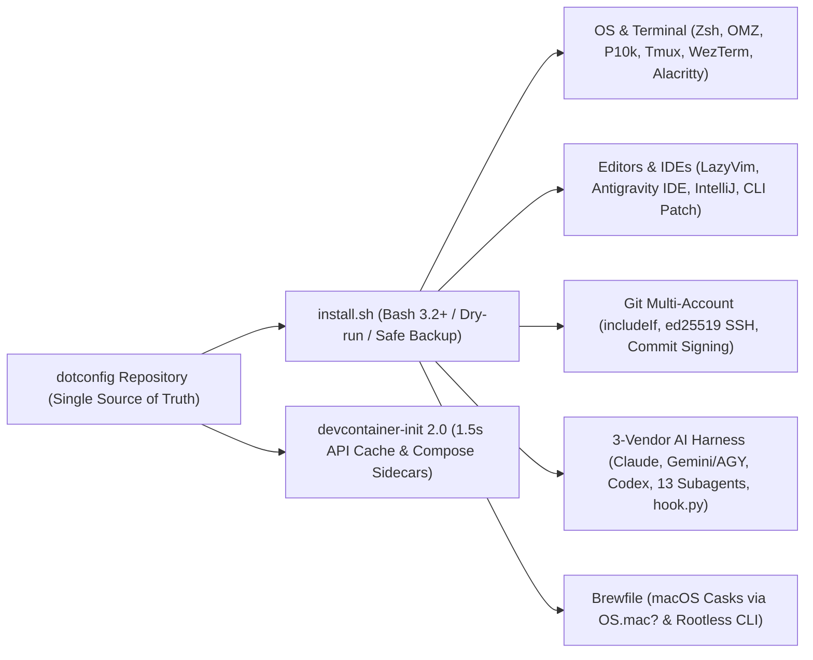

<div align="center">

# Dotconfig

**macOS · Ubuntu (Rootless) 크로스 플랫폼 개발 환경, 3사 AI 코딩 에이전트 하네스 & Dev Container 2.0 생성기**

[-blue?style=flat-square)](./install.sh)
[](./zsh/.zshrc)
[](./nvim)
[](./agents)
[](./devcontainers)
[](./LICENSE)

**한국어** | [English](./README.en.md)

[빠른 시작](#빠른-시작-quick-start) · [아키텍처 및 매핑](#아키텍처-및-심볼릭-링크-매핑-architecture--symlink-mapping) · [AI 에이전트 하네스](#1-ai-에이전트-3사-동기화-및-생명주기-훅-lifecycle-hook) · [Dev Container 2.0](#3-dev-container-20-동적-생성기-devcontainer-init) · [트러블슈팅 사례](#4-실전-트러블슈팅-및-환경-자동-보정) · [아키텍처 심화 문서](./docs/ARCHITECTURE.ko.md)

</div>

---

## 개요 (Overview)

개인 macOS 노트북과 `sudo` 권한이 없는 Ubuntu 클러스터·컨테이너 워크스테이션을 오가며 개발할 때, 매번 같은 도구와 보안 규칙을 수동으로 맞추는 번거로움을 없애기 위해 만든 **선언적 (Declarative) 개발 환경 저장소**입니다.

단순 설정 파일 모음에 그치지 않고, **단일 진실 공급원 (Single Source of Truth, SSoT)** 위에서 **3사 AI 코딩 에이전트(Claude Code, Google Antigravity / Gemini CLI, OpenAI Codex) 통합 하네스**, **단발성 Docker 기반 코드 포매터**, **멀티 계정 Git/SSH 격리**, 그리고 **Dev Container 2.0 동적 생성기**까지 하나의 설치 스크립트로 엮었습니다.

### 설계 원칙 (Design Principles)

* **무권한 크로스 플랫폼 부트스트랩 (Zero-Sudo Bootstrap)**: macOS에서는 Homebrew를, 루트 권한이 없는 Ubuntu/Linux에서는 `~/.linuxbrew`를 자동 설치합니다. `~/goinfre`가 감지되면 IDE 확장과 함께 Linuxbrew 본체·캐시까지 자동으로 옮겨 홈 쿼터 초과를 막습니다.
* **단일 진실 공급원 (Single Source of Truth, SSoT)**: 전역 지침, **13개 전문 서브에이전트**, 공용 생명주기 훅을 `agents/shared/` 한 곳에서만 관리하며 `install.sh agents` 실행 시 Claude·Gemini·Codex 경로로 동시에 연결합니다.
* **호스트 최소화 및 컨테이너 격리 (Thin Host, Ephemeral Tooling)**: 언어별 SDK와 런타임은 9종 Dev Container 템플릿에 격리하고, 다국어 자동 포매팅은 단발성 Docker 컨테이너(`dotconfig-formatter`)에서 실행해 호스트 OS 오염을 줄였습니다.
* **안전 우선 멱등성 (Safety-First & Idempotency)**: 모든 설치 동작은 `--dry-run` 시뮬레이션을 지원하며, 기존 설정 파일과 충돌할 때 덮어쓰지 않고 타임스탬프 백업(`~/.dotconfig_backups/backup_YYYYMMDD_HHMMSS/`)으로 보존합니다.

---

## 시스템 아키텍처 (System Architecture)



> C4 Model 계층도, 핵심 시퀀스 다이어그램, **아키텍처 결정 기록 (Architecture Decision Record, ADR)** 은 [아키텍처 가이드 (한국어)](./docs/ARCHITECTURE.ko.md)와 [Architecture Guide (English)](./docs/ARCHITECTURE.md)에 정리해 두었습니다.

---

## 빠른 시작 (Quick Start)

### 1. 원격 웹 부트스트랩 (Bootstrap Installer)

새 머신에 저장소가 아직 없더라도 명령어 한 줄로 사전 도구 확인, 저장소 클론(`~/.dotconfig`), 전체 모듈 심볼릭 링크 연결을 순차적으로 진행할 수 있습니다.

* 전체 환경 자동 구성 (패키지, 심볼릭 링크, 폰트, IDE 확장 동기화)

  ```bash
  /bin/bash -c "$(curl -fsSL https://raw.githubusercontent.com/gdtknight/dotconfig/main/install.sh)"
  ```

* 파일 시스템을 바꾸지 않고 실행 계획만 미리 확인

  ```bash
  /bin/bash -c "$(curl -fsSL https://raw.githubusercontent.com/gdtknight/dotconfig/main/install.sh)" -- --dry-run
  ```

* 원하는 모듈만 선택 설치 (예: Neovim, Git)

  ```bash
  /bin/bash -c "$(curl -fsSL https://raw.githubusercontent.com/gdtknight/dotconfig/main/install.sh)" -- nvim git
  ```

> 기본 클론 경로(`~/.dotconfig`)를 바꾸고 싶다면 실행 전에 `DOTCONFIG_DIR=~/my/path` 환경 변수를 지정하시면 됩니다.

### 2. 로컬 저장소 실행 및 모듈별 적용

클론한 저장소 안에서는 `./install.sh`로 원하는 모듈만 골라 적용할 수 있습니다.

> 기존 일반 파일을 백업 후 강제 교체하려면 `-f` 또는 `--force` 옵션을 함께 지정합니다.

* 전체 변경 예정 내역 시뮬레이션

  ```bash
  ./install.sh --dry-run all
  ```

* 전체 모듈 설치

  ```bash
  ./install.sh all
  ```

* Homebrew / Rootless Linuxbrew 부트스트랩 및 Brewfile 동기화

  ```bash
  ./install.sh packages
  ```

* Nerd Fonts (D2Coding, ComicShannsMono) 설치 및 CoreText / fc-cache 등록

  ```bash
  ./install.sh fonts
  ```

* 전역 Git 설정 및 대화형 멀티 계정 SSH/서명 설정

  ```bash
  ./install.sh git
  ```

* Zsh, Oh My Zsh, Powerlevel10k 및 플러그인 구성

  ```bash
  ./install.sh zsh
  ```

* Tmux (`~/.tmux.conf`), TPM 및 Tmux 플러그인 9종 동기화

  ```bash
  ./install.sh tmux
  ```

* 터미널 에뮬레이터 선택 설치 및 링크 (Alacritty [기본값] / WezTerm / 건너뛰기, 미선택 링크 자동 정리, `-f` 또는 `--terminal` 지원)

  ```bash
  ./install.sh terminal
  ```

* Neovim (LazyVim v14+) 설정 연결

  ```bash
  ./install.sh nvim
  ```

* IDE 설정·확장(18종) 동기화 및 Docker v29+ CLI 패치

  ```bash
  ./install.sh ide
  ```

* Claude, Gemini/AGY, Codex 규칙·서브에이전트·훅·CLI 동기화

  ```bash
  ./install.sh agents
  ```

* `dotconfig-formatter:latest` Docker 이미지 빌드

  ```bash
  ./install.sh formatter
  ```

* 현재 IDE 확장 목록을 `ide/antigravity-ide/extensions.txt`로 내보내기

  ```bash
  ./install.sh --dump-extensions
  ```

---

## 아키텍처 및 심볼릭 링크 매핑 (Architecture & Symlink Mapping)

```text
dotconfig/
├── install.sh                    # Bash 3.2+ 통합 오케스트레이터, 웹 부트스트래퍼 & CLI 패처
├── Brewfile                      # CLI 도구 및 macOS 전용 Cask / 폰트 목록 (if OS.mac? 분기)
├── README.md / README.en.md      # 포트폴리오 메인 문서 (한국어 / English)
├── CLAUDE.md / CLAUDE.ko.md      # 저장소 유지보수 지침 (AGENTS.md -> CLAUDE.md 심볼릭 링크)
├── docs/                         # 시스템 아키텍처 심화 가이드 및 ADR (영문 / 국문)
├── nvim/                         # LazyVim v14+, Obsidian 동적 Vault 스캔, devcontainer.nvim
├── zsh/                          # Zsh (.zshrc, .zprofile, .p10k.zsh) & devcontainer-init 자동완성
├── git/                          # 전역 .gitconfig (histogram diff, SSH 서명) & .gitignore
├── agents/                       # LLM 코딩 에이전트 3사 통합 하네스 (Claude, Gemini/AGY, Codex)
│   ├── shared/                   # SSoT: INSTRUCTIONS.md, rules/, 13개 전문 에이전트, skills/, mcp.json, sync_mcp.py, hook.py
│   ├── claude/                   # settings.json (Claude Code 훅 바인딩)
│   ├── gemini/                   # settings.json, config.json, hooks.json, mcp_config.json (Graphify MCP)
│   └── codex/                    # config.toml & 13개 TOML 서브에이전트 래퍼
├── ide/                          # Antigravity IDE / VS Code (18종 확장) & IntelliJ IDEA 설정
├── alacritty/                    # Alacritty 터미널 설정 및 테마
├── wezterm/                      # WezTerm Lua 설정 (wezterm.lua)
├── tmux/                         # Tmux 설정 (TPM 자동 설치 & vim-tmux-navigator 연동)
├── devcontainers/                # 9종 스택 템플릿 + Python 기반 Dev Container 2.0 생성 엔진
└── docker/formatter/             # 다국어 단발성 포매터 Docker 이미지 (Debian Bookworm Slim)
```

### 플랫폼별 심볼릭 링크 매핑

| 모듈 | 저장소 원본 | macOS 대상 경로 (`$HOME`) | Ubuntu / Linux 대상 경로 (`$HOME`) | 동작 방식 (Mechanism) |
| :--- | :--- | :--- | :--- | :--- |
| **Neovim** | `nvim` | `~/.config/nvim` | `~/.config/nvim` | 디렉터리 심볼릭 링크 (LazyVim, 9개 커스텀 플러그인) |
| **Zsh** | `zsh/{.zshrc,.zprofile,.p10k.zsh}` | `~/.zshrc`, `~/.zprofile`, `~/.p10k.zsh` | 동일 | 파일 심볼릭 링크 + Oh My Zsh, P10k, 플러그인 자동 부트스트랩 |
| **Git** | `git/{.gitconfig,.gitignore}` | `~/.gitconfig`, `~/.gitignore`, `~/Projects/<account>/` | 동일 | 파일 심볼릭 링크 + `includeIf` 계정별 SSH 키/서명 격리 |
| **Claude Code** | `agents/shared/*`, `agents/claude/settings.json` | `~/.claude/{CLAUDE.md,rules,agents,skills/*,hooks,settings.json}` | 동일 | 공용 지침·규칙·서브에이전트·스킬·훅 링크 + CLI 자동 설치 |
| **Gemini / AGY** | `agents/shared/*`, `agents/gemini/*` | `~/.gemini/{GEMINI.md,agents}`, `~/.gemini/config/{rules,hooks,mcp_config.json,skills/*}` | 동일 | 공용 규칙·스킬·MCP 설정 링크 + `agy` CLI 자동 설치 |
| **Codex** | `agents/shared/*`, `agents/codex/*` | `~/.codex/{AGENTS.md,config.toml,rules,agents,hooks,skills/*/SKILL.md}` | 동일 | 공용 규칙·스킬 & TOML 래퍼 링크 + CLI 자동 설치 |
| **IDE (AGY / Code)** | `ide/antigravity-ide/*` | `~/Library/Application Support/Antigravity IDE/User/*` | `~/.config/Code/User/*` (`~/goinfre` 확장 격리) | 설정 링크, 18종 확장 동기화 & Docker v29+ 호환 패치 |
| **IntelliJ IDEA** | `ide/intellij/*` | `~/Library/Application Support/JetBrains/IntelliJIdea*/*` | `~/.config/JetBrains/IntelliJIdea*/*` | 키맵 (`macOS.xml`), VM 옵션 & Properties 링크 |
| **Tmux** | `tmux/tmux.conf` | `~/.tmux.conf` | 동일 | 파일 심볼릭 링크 + TPM 및 Tmux 플러그인 9종 자동 설치 |
| **Terminal & Fonts** | `alacritty`, `wezterm/wezterm.lua` | `~/.config/alacritty` 또는 `~/.wezterm.lua` *(택 1)*, `~/Library/Fonts` | 동일 + `~/.config/wezterm/wezterm.lua`, `~/.local/share/fonts` | Alacritty(기본)·WezTerm 선택 링크(미선택 자동 정리) + 1단계 공통 Nerd Fonts & CoreText 등록 |

---

## 핵심 엔지니어링 구현 내용 (Engineering Highlights)

### 1. AI 에이전트 3사 동기화 및 생명주기 훅 (Lifecycle Hook)

Claude Code, Google Antigravity(Gemini CLI), OpenAI Codex는 설정 파일 경로와 훅 JSON 페이로드 형식이 모두 다릅니다. 이를 한 곳에서 통제하기 위해 `agents/shared/`를 단일 소스로 묶고 [`agents/shared/hooks/hook.py`](./agents/shared/hooks/hook.py)로 3사 훅 페이로드(`toolCall` vs `tool_name` / `tool_input`)를 정규화했습니다.

| 훅 이벤트 | 역할 및 동작 방식 |
| :--- | :--- |
| **`PreToolUse`** | • **파괴적 명령 선별 차단**: 토큰 단위 파서(`is_dangerous_rm`, `is_dangerous_chmod`)로 `/`, `~`, `$HOME`, 시스템 핵심 디렉터리 전체 삭제나 재귀 777 권한 부여만 골라 차단하고 `/tmp/...` 같은 안전한 하위 경로 정리는 허용합니다. `git push --force`, `git reset --hard`, `git clean -f`, `mkfs`, `dd`도 함께 막습니다.<br>• **시크릿·토큰 유출 방지**: `.env` 및 개인키 파일 직접 접근을 차단(단, `.env.example`/`.sample`/`.template` 예외)하고 GitHub(`ghp_`, `github_pat_`), OpenAI(`sk-`), Google(`AIzaSy`), AWS(`AKIA`), Slack(`xox*`) 토큰 패턴을 탐지합니다. |
| **`PostToolUse`** | • **단발성 컨테이너 자동 포매팅**: 파일 수정 직후 `dotconfig-formatter:latest` (`prettier`, `ruff`, `clang-format`, `stylua`, `google-java-format` v1.24.0)를 `docker run --rm`으로 실행합니다. (`.excalidraw.md`/`.excalidraw` 파일은 `%%...%%` 블록 보호를 위해 Prettier에서 제외) Docker 데몬이 꺼져 있으면 로컬 포매터 바이너리로 자연스럽게 폴백(Fallback)합니다. |
| **`Stop`** | • **원래 창 포커스 알림 (Context-Aware Activation)**: macOS에서 작업 완료 시 `terminal-notifier` (`-activate`) 및 AppleScript로 호출 앱(`Antigravity IDE`, `WezTerm`, `Alacritty`, `iTerm2`, `Terminal`)을 판별해 알림을 보냅니다. 알림을 클릭하면 스크립트 편집기가 아니라 작업 중이던 에디터·터미널 창이 바로 올라옵니다. |

또한 [`agents/shared/agents/`](./agents/shared/agents) 아래에 **13개 전문 서브에이전트**를 운용하고 있습니다.

* **리뷰·품질**: `@code-reviewer` (OWASP/STRIDE/Fowler/SonarQube 종합 및 병렬 위임), `@security-reviewer`, `@quality-reviewer`
* **테스트·디버깅·개선**: `@test-agent`, `@unit-test-agent`, `@integration-test-agent`, `@debug-agent` (최대 3라운드 가설 검증 & 에스컬레이션), `@refactor-agent` (Baby Steps & `hook.py` 호환 파일 단위 복구)
* **문서·Git 워크플로우**: `@commit-agent` (GitHub Flow·이슈 연동), `@github-agent` (GitHub Flow·CI 머지·`--body-file -`), `@docs-agent`, `@guide-writer` (C4 Model·ADR·Excalidraw), `@human-writer` (AI 상투어·서술형 종결어미·1인칭 제거 및 간결한 톤 프리셋 적용)
* **작업 비중별 3사 모델 티어링**: 심층 추론·설계·리뷰 8종과 빠른 실행·테스트·Git/주석 5종을 Claude(`opus`/`sonnet`), Codex(`model_reasoning_effort` `high`/`medium`), Antigravity(`INSTRUCTIONS.md` 기반 `pro`/`flash` 티어 전달)로 차등 배정했습니다.
* **공용 스킬 & MCP 동기화**: [`agents/shared/skills/graphify`](./agents/shared/skills/graphify), [`agents/shared/skills/llm-wiki`](./agents/shared/skills/llm-wiki) 같은 다중 파일 스킬과 [`agents/shared/mcp.json`](./agents/shared/mcp.json) MCP 서버 목록을 [`sync_mcp.py`](./agents/shared/sync_mcp.py)가 Claude(`~/.claude.json` 병합)·Gemini/AGY(`serverUrl`)·Codex(TOML) 규격에 맞춰 일괄 동기화합니다.

### 2. 멀티 계정 Git 및 SSH 격리 (`includeIf`)

회사/학교 계정과 개인 계정을 한 장비에서 쓸 때 리모트 URL을 매번 고쳐 쓰거나 서명 키가 섞이지 않도록, 디렉터리 경로 기준의 조건부 설정(`includeIf`)을 자동화했습니다.

```text
~/Projects/
├── <account1>/      # ~/.gitconfig-<account1> 적용 (전용 id_ed25519_<account1> 키 + SSH 커밋 서명)
└── <account2>/      # ~/.gitconfig-<account2> 적용 (전용 id_ed25519_<account2> 키 + SSH 커밋 서명)
```

* [`git/.gitconfig`](./git/.gitconfig)에는 `histogram` diff, `rebase.autoStash`, `commit.gpgsign = true` (`gpg.format = ssh`) 등 공통 규칙만 두고, 개인 식별 정보는 저장소 밖 `~/.config/dotconfig/git-accounts.env`와 `~/.gitconfig.local`에만 생성합니다.
* `sshCommand` 스코프를 계정별 설정 파일에 한정해 일반 `~/.ssh/config` 호스트 규칙이 영향을 받지 않도록 분리했습니다.

### 3. Dev Container 2.0 동적 생성기 (`devcontainer-init`)

[`devcontainers/`](./devcontainers)에는 9종 스택 템플릿(`42-c-valgrind`, `devops-cloud`, `fullstack-db`, `go-backend`, `java`, `node-ts`, `python-ai`, `react-native`, `rust`)과 외부 패키지 의존성 없는 **Python 3 표준 라이브러리 전용 CLI 엔진**이 들어 있습니다. `zsh/.zshrc`의 Zsh 탭 자동완성(`_devcontainer_init_completion`)과 바로 연결됩니다.

* **1.5초 타임아웃 스마트 버전 캐시 ([`version_fetcher.py`](./devcontainers/scripts/version_fetcher.py))**: `nodejs.org`, `endoflife.date`, `go.dev` 공식 API에서 활성 버전을 1.5초 제한으로 조회하고 `~/.cache/dotconfig/devcontainer-versions.json`에 캐싱합니다. 오프라인·폐쇄망 환경에서는 즉시 안전 기본값(`DEFAULT_FALLBACKS`)으로 전환합니다.
* **Compose 사이드카 자동 승격 ([`db_templates.py`](./devcontainers/scripts/db_templates.py))**: `--db` 옵션으로 로컬 데이터베이스(`postgres`, `redis`, `mysql`, `mongo`)를 하나 이상 선택하면 단일 컨테이너 템플릿을 영속 볼륨이 포함된 멀티 컨테이너 `docker-compose.yml` 구성으로 자동 승격합니다.
* **듀얼 모드 CLI & Neovim 마운트 ([`init_devcontainer.py`](./devcontainers/scripts/init_devcontainer.py))**: 대화형 마법사(`-i`)와 스크립트용 비대화형 플래그(`-y`)를 모두 지원하며, `--nvim`/`--no-nvim`, `--docker-socket`, `--ai`, `--no-install` 옵션으로 컨테이너 내부 작업 환경을 세밀하게 제어할 수 있습니다. (호스트 Neovim의 `devcontainer.nvim` `<leader>D` 키맵과도 연동됩니다.)

* 대화형 마법사 실행 (실시간 활성 SDK 버전 목록 표시)

  ```bash
  devcontainer-init node-ts
  ```

* 비대화형 구성 (Node 22 + pnpm + PostgreSQL/Redis 사이드카 + 포트 3000, 8080)

  ```bash
  devcontainer-init node-ts --version 22 --pkg pnpm --db postgres,redis --port 3000,8080
  ```

* Python AI 환경 (Python 3.12 + uv + 포트 8888 + 컨테이너 내 AI Agent CLI 포함)

  ```bash
  devcontainer-init python-ai --version 3.12 --pkg uv --port 8888 --ai
  ```

### 4. 실전 트러블슈팅 및 환경 자동 보정

실제 macOS, SSH 원격 서버, 42 클러스터 Linux 환경에서 부딪힌 문제들을 수동 우회 대신 코드와 설치 파이프라인 수준에서 해결했습니다.

| 겪은 문제 (Problem) | 적용한 해결 (Solution) | 구현 위치 |
| :--- | :--- | :--- |
| **Docker v29+ 환경에서 Antigravity IDE Dev Containers 기동 멈춤** | 내장 `devContainersSpecCLI.js`의 이벤트 상태 조건(`i.status\|\|i.Status`)에 `\|\|i.Action`이 빠져 컨테이너 준비를 인식 못 하는 문제를 설치 시 자동 패치(`patch_antigravity_dev_containers`)하도록 구현했습니다. | [install.sh](./install.sh#L507-L523) |
| **AI 채팅 입력창에서 WhichKey 스페이스바 단축키 오동작** | Vim Normal 모드의 `space -> whichkey.show` 트리거가 AI 채팅 입력·터미널에서도 가로채기를 일으켜 `!antigravity.chatFocused && !inChat && !chatFocus && !chatInputHasFocus` 컨텍스트 가드로 정밀 격리했습니다. | [keybindings.json](./ide/antigravity-ide/keybindings.json#L105-L125) |
| **클러스터 NFS 홈 쿼터 제한 및 Rootless 환경** | `~/goinfre` 경로 감지 시 `.vscode/extensions`·`.antigravity-ide/extensions`와 Linux의 `~/.linuxbrew`·`~/.cache/Homebrew`를 내부 심볼릭 링크 손상 없이 격리하고, `Brewfile`의 macOS GUI 앱을 `if OS.mac?` 블록으로 분리했습니다. | [install.sh](./install.sh) · [Brewfile](./Brewfile) |
| **SSH 원격 접속 시 `EDITOR` 덮어쓰기 & Zsh 경로 꼬임** | `zsh/.zshrc`에서 Oh My Zsh 로딩 *이전*에 Homebrew `shellenv`를 초기화하고, `$SSH_CONNECTION` 여부와 무관하게 설치된 `nvim`을 우선 `EDITOR`로 고정했으며 `_dotconfig_repo_dir()`로 실제 저장소 위치를 동적 역추적합니다. | [zsh/.zshrc](./zsh/.zshrc) |
| **Obsidian Vault 동적 인식 & Neovim 유연한 마크다운 편집** | `obsidian.nvim` 설정이 iCloud Obsidian 폴더 내 모든 Vault를 알파벳순으로 자동 등록하고, Vault 바깥에서 마크다운 파일을 열 때는 현재 파일 디렉터리를 기준으로 동작하는 `no-vault` 폴백을 제공합니다. | [obsidian.nvim.lua](./nvim/lua/plugins/obsidian.nvim.lua#L1-L42) |

---

## 문서 목록 (Documentation Index)

| 문서 | 한국어 | English |
| :--- | :--- | :--- |
| **메인 매뉴얼 & 심볼릭 링크 매핑** | [README.md](./README.md) | [README.en.md](./README.en.md) |
| **시스템 아키텍처 & ADR** | [docs/ARCHITECTURE.ko.md](./docs/ARCHITECTURE.ko.md) | [docs/ARCHITECTURE.md](./docs/ARCHITECTURE.md) |
| **저장소 유지보수 & 에이전트 규칙** | [CLAUDE.ko.md](./CLAUDE.ko.md) | [CLAUDE.md](./CLAUDE.md) |
| **라이선스** | [LICENSE](./LICENSE) (MIT) | [LICENSE](./LICENSE) (MIT) |

---

## 라이선스 (License)

이 프로젝트는 [MIT License](./LICENSE) 조건에 따라 배포됩니다.
