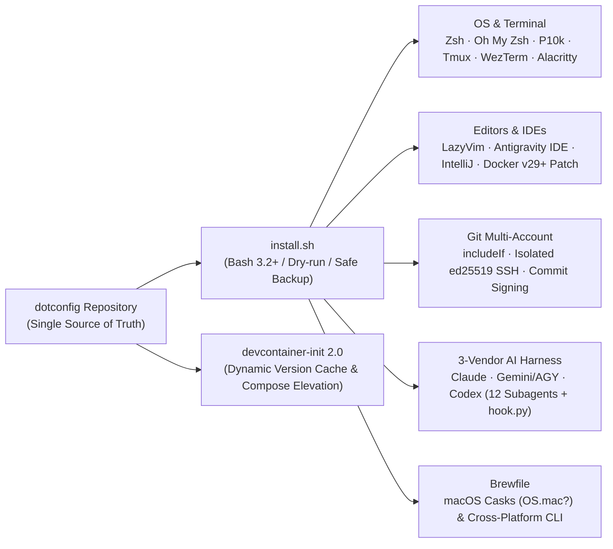

<div align="center">

# Dotconfig

**Cross-Platform, Zero-Sudo Developer Environment, Multi-Vendor AI Agent Harness & Dynamic Dev Container 2.0**

[-blue?style=flat-square)](./install.sh)
[](./zsh/.zshrc)
[](./nvim)
[](./agents)
[](./devcontainers)
[](./LICENSE)

**English** | [한국어](./README.ko.md)

[Quick Start](#-quick-start) · [Architecture](#-architecture--symlink-mapping) · [AI Agent Harness](#-ai-agent-lifecycle-hooks) · [Dev Container 2.0](#-dev-container-20-generator) · [Deep-Dive Docs](./docs/ARCHITECTURE.md)

</div>

---

## Overview

**Dotconfig** is a declarative, **Single Source of Truth (SSOT)** workspace repository that provisions and synchronizes a full-stack engineering environment across **macOS** and **Ubuntu/Linux (including rootless / non-sudo university or cluster environments)**.

Built for real-world developer productivity, it goes beyond static dotfiles by integrating a **3-vendor AI Agent Harness** (`Claude Code`, `Google Antigravity CLI`, `OpenAI Codex`), **ephemeral Docker-based formatting**, **multi-account Git/SSH isolation**, and a **dynamic Dev Container 2.0 CLI generator**.

### Design Principles

* **Zero-Sudo Cross-Platform Bootstrap**: Self-bootstraps Homebrew on macOS and rootless Linuxbrew (`~/.linuxbrew`) on Ubuntu, with automatic NFS quota relocation (`~/goinfre`) for IDE extensions.
* **Single Source of Truth (SSOT)**: Shared agent rules, 12 specialized subagents, and lifecycle hooks live in `agents/shared/` and sync across Claude, Gemini/Antigravity, and Codex automatically.
* **Thin Host, Ephemeral Tooling**: Language toolchains and code formatters stay isolated inside Dev Containers and on-demand Docker containers (`dotconfig-formatter`) rather than polluting the host OS.
* **Safe & Idempotent Execution**: Every installation supports `--dry-run`, preserves existing configurations in timestamped backups (`~/.dotconfig_backups/`), and guarantees zero secret leakage via `.gitignore` and PreToolUse guards.

---

## System Architecture



> For C4 diagrams, sequence flows, and **Architecture Decision Records (ADR)**, see [docs/ARCHITECTURE.md](./docs/ARCHITECTURE.md).

---

## Quick Start

### Web One-Line Bootstrap (Fresh OS)

Run a single command on a brand-new machine to install prerequisites (Xcode CLI Tools / Homebrew on macOS), clone the repository to `~/.dotconfig`, and link all modules:

```bash
# Full automated setup (packages, symlinks, fonts, IDE extensions)
/bin/bash -c "$(curl -fsSL https://raw.githubusercontent.com/gdtknight/dotconfig/main/install.sh)"

# Preview actions without modifying files
/bin/bash -c "$(curl -fsSL https://raw.githubusercontent.com/gdtknight/dotconfig/main/install.sh)" -- --dry-run

# Install specific modules only (e.g., Neovim and Git)
/bin/bash -c "$(curl -fsSL https://raw.githubusercontent.com/gdtknight/dotconfig/main/install.sh)" -- nvim git
```

> **Tip**: Override the default clone path (`~/.dotconfig`) by setting `DOTCONFIG_DIR=~/my/path` before running the command.

### Local Repository Execution

Inside an already-cloned repository, run `./install.sh` selectively (**no `sudo` required**):

```bash
./install.sh --dry-run all      # Preview all symlinks and actions
./install.sh all                # Apply full environment setup

# Modular execution
./install.sh packages           # Bootstrap Homebrew/Linuxbrew & sync Brewfile
./install.sh nvim               # Link LazyVim v14+ configuration
./install.sh zsh                # Link Zsh, Oh My Zsh, Powerlevel10k & plugins
./install.sh git                # Link global Git config & interactive multi-account setup
./install.sh agents             # Sync Claude, Gemini/AGY, Codex configs, skills & CLIs
./install.sh ide                # Link IDE settings, sync extensions & patch Docker v29+ CLI
./install.sh terminal           # Link Alacritty, WezTerm, Tmux, TPM plugins & Nerd Fonts
./install.sh fonts              # Install Nerd Fonts (D2Coding, ComicShannsMono)
./install.sh formatter          # Build dotconfig-formatter Docker image

./install.sh --dump-extensions  # Export current Antigravity IDE extensions to extensions.txt
```

---

## Architecture & Symlink Mapping

```text
dotconfig/
├── install.sh                  # Cross-platform symlink installer, web bootstrapper & patcher
├── Brewfile                    # Curated CLI & macOS-only Cask manifest (OS.mac? guarded)
├── README.md / README.ko.md    # Bilingual documentation (English / Korean)
├── CLAUDE.md / CLAUDE.ko.md    # Repository maintenance & agent guidelines (AGENTS.md -> CLAUDE.md)
├── docs/                       # Deep-dive system architecture & ADRs (English / Korean)
├── nvim/                       # LazyVim v14+, Obsidian dynamic vault scan, devcontainer.nvim
├── zsh/                        # Zsh (.zshrc, .zprofile, .p10k.zsh) & devcontainer-init wrapper
├── git/                        # Global .gitconfig (SSH signing, histogram diff) & .gitignore
├── agents/                     # Multi-vendor AI Agent harness (Claude, Gemini/AGY, Codex)
│   ├── shared/                 # SSOT: INSTRUCTIONS.md, rules/, 12 specialized agents/, hooks/
│   ├── claude/                 # settings.json (Claude Code hook bindings)
│   ├── gemini/                 # settings.json, config.json, hooks.json, mcp_config.json
│   └── codex/                  # config.toml & TOML subagent wrappers
├── ide/                        # Antigravity IDE / VS Code (18 extensions) & IntelliJ IDEA
├── alacritty/                  # Alacritty terminal config & themes
├── wezterm/                    # WezTerm Lua configuration
├── tmux/                       # Tmux config with TPM plugins & vim-tmux-navigator
├── devcontainers/              # 9 templates + Python-based Dev Container 2.0 generator engine
└── docker/formatter/           # Multi-language ephemeral code formatter Docker image
```

### Detailed Mapping Table

| Module | Repository Source | macOS Target (`$HOME`) | Ubuntu/Linux Target (`$HOME`) | Mechanism |
| :--- | :--- | :--- | :--- | :--- |
| **Neovim** | `nvim` | `~/.config/nvim` | `~/.config/nvim` | Directory symlink (LazyVim v14+, Obsidian, Devcontainer) |
| **Zsh** | `zsh/{.zshrc,.zprofile,.p10k.zsh}` | `~/.zshrc`, `~/.zprofile`, `~/.p10k.zsh` | `~/.zshrc`, `~/.zprofile`, `~/.p10k.zsh` | File symlinks + auto Oh My Zsh, P10k & plugin bootstrap |
| **Git** | `git/{.gitconfig,.gitignore}` | `~/.gitconfig`, `~/.gitignore`, `~/Projects/<account>/` | `~/.gitconfig`, `~/.gitignore`, `~/Projects/<account>/` | File symlinks + `includeIf` multi-account SSH & signing |
| **Claude** | `agents/shared/*`, `agents/claude/settings.json` | `~/.claude/{CLAUDE.md,rules,agents,hooks,settings.json}` | `~/.claude/{CLAUDE.md,rules,agents,hooks,settings.json}` | Shared markdown & hook symlinks + CLI auto-install |
| **Gemini / AGY** | `agents/shared/*`, `agents/gemini/*` | `~/.gemini/{GEMINI.md,agents}`, `~/.gemini/config/{rules,hooks,skills/*/SKILL.md}` | Same as macOS | Shared rules/skills symlinks + `agy` CLI auto-install |
| **Codex** | `agents/shared/*`, `agents/codex/*` | `~/.codex/{AGENTS.md,config.toml,agents,hooks,skills/*/SKILL.md}` | Same as macOS | Shared skills & TOML wrapper links + CLI auto-install |
| **IDE (AGY / Code)** | `ide/antigravity-ide/*` | `~/Library/Application Support/Antigravity IDE/User/*` | `~/.config/Code/User/*` (`~/goinfre` extension isolation) | Settings symlinks, 18-extension sync & Docker v29+ patch |
| **IntelliJ IDEA** | `ide/intellij/*` | `~/Library/Application Support/JetBrains/IntelliJIdea*/*` | `~/.config/JetBrains/IntelliJIdea*/*` | Keymap (`macOS.xml`), VM options & properties links |
| **Terminal** | `alacritty`, `wezterm/wezterm.lua`, `tmux/tmux.conf` | `~/.config/alacritty`, `~/.wezterm.lua`, `~/.tmux.conf`, `~/Library/Fonts` | Same + `~/.config/wezterm/wezterm.lua`, `~/.local/share/fonts` | Symlinks + auto TPM plugin sync + Nerd Fonts |

---

## Core Engineering Highlights

### 1. AI Agent Lifecycle Hooks

[`agents/shared/hooks/hook.py`](./agents/shared/hooks/hook.py) provides a unified cross-platform lifecycle hook shared by Claude Code, Gemini/Antigravity, and Codex:

| Hook Event | Capability & Behavior |
| :--- | :--- |
| **PreToolUse** | • **Destructive Command Guard**: Token-aware parsers (`is_dangerous_rm`, `is_dangerous_chmod`) block root (`/`), home (`~`, `$HOME`), and critical system directories while safely permitting subpath cleanup (e.g., `/tmp/...`). Blocks `git push --force`, `git reset --hard`, `mkfs`, `dd`.<br>• **Secret & Token Leak Prevention**: Blocks direct access to `.env`, private keys, and credential files, and detects GitHub, OpenAI, Google, AWS, and Slack token patterns. |
| **PostToolUse** | • **Ephemeral Container Formatting**: Formats modified files via `dotconfig-formatter:latest` (`prettier`, `ruff`, `google-java-format`, `clang-format`, `stylua`) with seamless fallback to local formatters when Docker is unavailable. |
| **Stop** | • **Context-Aware Window Activation**: Sends macOS native notifications via `terminal-notifier` (`-activate`) and dynamically detects the originating app (`Antigravity IDE`, `WezTerm`, `Alacritty`, `iTerm2`, `Terminal`) so clicking the toast focuses the exact workspace window instead of Script Editor. |

### 2. Multi-Account Git & SSH Isolation

Manage multiple GitHub accounts (e.g., work/school and personal) on a single machine without rewriting remote URLs:

```text
~/Projects/
├── <account1>/      # Uses ~/.gitconfig-<account1> (dedicated ed25519 key + SSH signingkey)
└── <account2>/      # Uses ~/.gitconfig-<account2> (dedicated ed25519 key + SSH signingkey)
```

* Interactive account registration stores personal identities outside the repository in `~/.config/dotconfig/git-accounts.env` and `~/.gitconfig.local`.
* Public keys are automatically copied via `pbcopy` (on macOS) with direct GitHub SSH key registration prompts.
* `sshCommand` stays scoped to per-account configs so unrelated SSH hosts (`~/.ssh/config`) remain unaffected.

### 3. Dev Container 2.0 Generator

[`devcontainers/`](./devcontainers) includes **9 production-ready templates** (`42-c-valgrind`, `fullstack-db`, `go-backend`, `python-ai`, `devops-cloud`, `rust`, `java`, `node-ts`, `react-native`) powered by a Python 3 standard-library engine (`devcontainer-init`):

* **Smart Version Cache (`version_fetcher.py`)**: Queries official release APIs (`nodejs.org`, `endoflife.date`, `go.dev`) with a 1.5s timeout and updates `~/.cache/dotconfig/devcontainer-versions.json` for resilient offline fallback.
* **Auto Compose Elevation (`db_templates.py`)**: Checking any local database (`postgres`, `redis`, `mysql`, `mongo`) automatically elevates single-container configs into a multi-service `docker-compose.yml`.
* **Dual-Mode CLI (`init_devcontainer.py`)**: Supports both an interactive prompt wizard and non-interactive scriptable flags with full Zsh tab completion.

```bash
# Interactive wizard (lists live active SDK versions)
devcontainer-init node-ts

# Scriptable one-liner: Node 22 + pnpm + Postgres + Redis + ports 3000,8080
devcontainer-init node-ts --version 22 --pkg pnpm --db postgres,redis --port 3000,8080

# Python AI: Python 3.12 + uv + port 8888 + bundled AI Agent CLIs
devcontainer-init python-ai --version 3.12 --pkg uv --port 8888 --ai
```

### 4. Safe Backup & Package Management

* Existing non-symlink files are never overwritten; they are safely relocated to `~/.dotconfig_backups/backup_YYYYMMDD_HHMMSS/` preserving directory hierarchy.
* [`Brewfile`](./Brewfile) guards GUI applications and Nerd Fonts inside `if OS.mac?` so Ubuntu/Linux nodes install only CLI tooling cleanly without root access.

---

## Documentation Index

| Document | English | 한국어 |
| :--- | :--- | :--- |
| **Main Manual & Mapping** | [README.md](./README.md) | [README.ko.md](./README.ko.md) |
| **Architecture & Decisions (ADR)** | [docs/ARCHITECTURE.md](./docs/ARCHITECTURE.md) | [docs/ARCHITECTURE.ko.md](./docs/ARCHITECTURE.ko.md) |
| **Agent & Contributor Guidelines** | [CLAUDE.md](./CLAUDE.md) | [CLAUDE.ko.md](./CLAUDE.ko.md) |

---

## License

Released under the [MIT License](./LICENSE).
