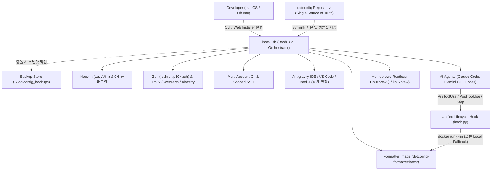
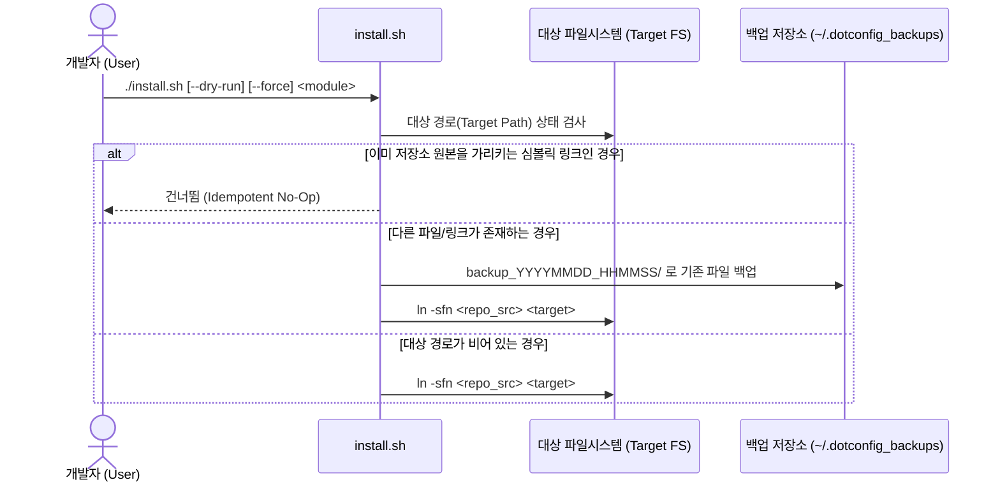
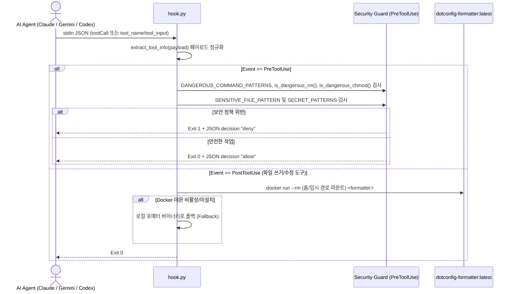

[English](./ARCHITECTURE.md) | **한국어**

# Dotconfig 아키텍처 가이드 (Architecture Guide)

이 문서는 `dotconfig`의 전체 시스템 구조, 핵심 런타임 워크플로우, 모듈별 내부 설계, 그리고 **아키텍처 결정 기록 (Architecture Decision Record, ADR)** 을 정리한 심화 기술 문서입니다.

---

## 1. 시스템 컨텍스트 및 컨테이너 아키텍처 (C4 Model)

`dotconfig`는 macOS 및 Ubuntu Linux(Rootless 클러스터 환경 포함) 워크스테이션을 위한 선언적 **단일 진실 공급원 (Single Source of Truth, SSoT)** 입니다. **멱등성 (Idempotency)** 을 보장하는 Bash 오케스트레이터가 저장소 리소스를 **심볼릭 링크 (Symlink)** 로 대상 경로에 투영하여 호스트 환경의 비추적 변이를 방지합니다.

---

## 2. 핵심 런타임 워크플로우 (Core Runtime Workflows)

### 2.1 멱등적 배포 및 무손실 백업 흐름 (Idempotent Deployment & Backup)

`install.sh`는 심볼릭 링크를 생성·갱신하기 전에 `--dry-run` 시뮬레이션을 지원하며, 기존 파일이 충돌할 경우 타임스탬프 기반 백업 디렉터리로 먼저 이동시킵니다.

### 2.2 통합 AI 에이전트 생명주기 훅 (Unified AI Agent Lifecycle Hook)

`agents/shared/hooks/hook.py`는 Claude Code, Gemini CLI / Antigravity, Codex 간 서로 다른 JSON 페이로드 스키마를 정규화하여 단일 보안 가드 및 자동 포매팅 파이프라인으로 처리합니다.

---

## 3. 모듈별 내부 설계 (Module Breakdown)

### 3.1 통합 설치 오케스트레이터 및 패키지 관리 (`install.sh`, `Brewfile`)
- **Bash 3.2+ 호환성**: 연관 배열(Associative Array) 등 Bash 4+ 전용 문법을 배제하여 기본 macOS 환경에서도 `set -euo pipefail` 기반으로 즉시 실행됩니다.
- **웹 부트스트랩 (Web Bootstrap)**: 원격 1줄 실행 시 `DOTCONFIG_DIR`(기본 `~/.dotconfig`)로 `https://github.com/gdtknight/dotconfig.git`을 클론·갱신한 뒤 `all` 계층형 기본 순서(`packages` → `fonts` → `git` 기본 링크 → `zsh` → `tmux` → `terminal` → `nvim` → `ide` → `agents` → `git` 계정 마법사) 또는 지정한 모듈(`formatter` 포함)을 실행합니다. (`formatter` 이미지 빌드는 필요 시 `./install.sh formatter`로 별도 실행)
- **루트리스(Rootless) 및 OS 분기**: `Brewfile`에서 macOS 전용 GUI Cask(`google-chrome`, `alfred`, `rectangle`, `orbstack`), `terminal-notifier`, Nerd Fonts를 `if OS.mac?` 블록으로 격리하여 Ubuntu Rootless 환경(`~/.linuxbrew`)에서도 CLI 도구(`neovim`, `tmux`, `eza`, `zoxide`, `fzf`, `ripgrep`, `bat`, `lazygit`, `gh`)가 에러 없이 설치됩니다. 터미널 에뮬레이터(`alacritty` 기본값 / `wezterm`)는 `./install.sh terminal` 단계에서 선택 설치됩니다.

### 3.2 3사 AI 에이전트 동기화 및 보안 가드 (`agents/`)
- **통합 프롬프트·스킬·MCP 트리**: `agents/shared/`에 전역 지침(`INSTRUCTIONS.md`), 세부 규칙(`rules/`), **13개 전문 에이전트**(`agents/shared/agents/*.md`, `agents/codex/agents/*.toml`와 1:1 매핑), 다중 파일 공용 스킬 디렉터리(`agents/shared/skills/<name>/` — `graphify`, `llm-wiki`), 공용 MCP 선언(`agents/shared/mcp.json`)을 단일 관리합니다.
- **작업 비중별 3사 모델 티어링**: 심층 추론·설계·리뷰 역할(8종)과 빠른 실행·단위/통합 테스트·Git/주석 역할(5종)을 Claude(`opus`/`sonnet`), Codex(`model_reasoning_effort` `high`/`medium`), Antigravity(`INSTRUCTIONS.md` 기반 `pro`/`flash` 티어 위임)로 일관되게 배정합니다.
- **플랫폼 어댑터 및 3사 MCP 동기화**: `install.sh agents`가 `agents/shared/sync_mcp.py`를 실행해 `mcp.json`을 Gemini/AGY(`agents/gemini/mcp_config.json`, `serverUrl`), Codex(`agents/codex/config.toml`의 `[mcp_servers.*]` TOML 블록), Claude Code(`~/.claude.json` 동적 상태 보존 병합) 포맷으로 동기화한 뒤 `~/.claude/`, `~/.gemini/`, `~/.codex/` 링크와 CLI 설치를 연계합니다.
- **생명주기 훅 (Lifecycle Hook, `hook.py`)**:
  - `PreToolUse` (`handle_pre_tool()`): 위험 Git/디스크 명령(`git push --force`, `git reset --hard`, `git clean -f`, `mkfs`, `dd`), 루트·홈·시스템 디렉터리 대상 `rm`(`is_dangerous_rm()`), 광범위 `chmod 777`(`is_dangerous_chmod()`), 시크릿 파일 및 API 키 노출(`SENSITIVE_FILE_PATTERN`, `SECRET_PATTERNS`)을 선별 차단합니다.
  - `PostToolUse` (`handle_post_tool()`): 수정된 파일 확장자(`.js`, `.ts`, `.py`, `.c`, `.cpp`, `.lua`, `.java` 등)에 따라 `prettier`, `ruff`, `clang-format`, `stylua`, `google-java-format`을 단발성 컨테이너(`dotconfig-formatter:latest`)에서 실행하며(`.excalidraw.md`/`.excalidraw` 파일은 Prettier 제외), Docker 미가용 시 로컬 바이너리로 폴백합니다.

### 3.3 IDE 용량 격리 및 호환성 패치 (`ide/`, `nvim/`)
- **Neovim (LazyVim)**: `nvim/`을 `~/.config/nvim`에 연결하며 `nvim/lua/plugins/` 아래 **9개 플러그인 설정**(`42format.lua`, `42header.lua`, `bufferline.lua`, `devcontainer.nvim.lua`, `emoji-picker.nvim.lua`, `markview.nvim.lua`, `obsidian.nvim.lua`, `tokyonight-nvim.lua`, `vim-tmux-navigator.lua`)을 관리합니다.
- **쿼터 제한 환경 격리 (`~/goinfre`)**: `~/goinfre` 존재 시 `setup_goinfre_symlink`가 `.vscode/extensions`·`.antigravity-ide/extensions`(`link_ide`)뿐만 아니라 Linux 환경의 `~/.linuxbrew`·`~/.cache/Homebrew`(`install_packages`)까지 내부 심볼릭 링크·숨김 파일 손상 없이 `~/goinfre`로 격리합니다.
- **Antigravity IDE Dev Containers 패치**: `patch_antigravity_dev_containers` 함수가 컨테이너 상태 비교 구문(`"start"===(i.status||i.Status)`)에 `||i.Action` 체크를 보강하여 CLI 버전 간 호환성을 확보합니다.
- **선언적 확장 목록**: `ide/antigravity-ide/extensions.txt`에 **18개 확장 프로그램**을 관리하며 `./install.sh --dump-extensions`로 현재 IDE 상태를 역동기화합니다.

### 3.4 셸, 폰트 및 멀티 계정 Git 격리 (`zsh/`, `alacritty/`, `wezterm/`, `tmux/`, `git/`)
- **결정론적 셸 초기화 (`zsh/.zshrc`)**: `typeset -U`로 `PATH`/`FPATH` 중복을 제거하고, Oh My Zsh 로딩 *이전*에 Homebrew `shellenv`를 초기화하며, SSH 세션에서도 설치된 `nvim`을 `EDITOR`로 우선 적용합니다. `__p9k_sourced` 가드도 함께 제공합니다.
- **멀티 계정 Git/SSH 격리**: `setup_git_accounts`가 `~/.config/dotconfig/git-accounts.env`, 계정별 `~/.gitconfig-<user>`, `~/.gitconfig.local`을 생성하고 `sshCommand` 스코프를 계정별로 엄격히 분리합니다.
- **Tmux, 터미널 선택 및 공용 폰트 자동화**: `install.sh fonts`가 1단계에서 macOS(CoreText 등록)·Linux(zip 다운로드 + `fc-cache`) 공통으로 D2Coding / ComicShannsMono Nerd Fonts를 설치합니다. `install.sh tmux`가 TPM 클론 및 Tmux 플러그인 9종을 먼저 동기화하며, `install.sh terminal`은 `~/.config/dotconfig/terminal.env` 상태 파일을 기반으로 Alacritty(기본값)·WezTerm·건너뛰기 중 1개를 선택·설치(macOS Cask)·링크하고 미선택 저장소 심볼릭 링크를 자동 정리합니다.

---

## 4. 아키텍처 결정 기록 (Architecture Decision Records, ADRs)

### ADR-01: GNU Stow / Chezmoi 대신 Bash 3.2+ 단일 오케스트레이터 채택
- **배경 (Context)**: 초기 macOS(기본 Bash 3.2, 패키지 매니저 미설치 상태)와 `sudo` 권한이 없는 Linux 클러스터 노드 모두에서 추가 바이너리 설치 없이 동작해야 합니다.
- **결정 (Decision)**: 외부 의존성 없는 순수 Bash 3.2+ 스크립트(`install.sh`)로 심볼릭 링크, 백업, 드라이런, 부트스트랩을 통합 구현합니다.
- **결과 (Consequences)**: 클린 머신에서 `curl | bash` 1줄만으로 Homebrew 설치 전 단계부터 즉시 부트스트랩이 가능하며, `--dry-run`과 `~/.dotconfig_backups` 백업 일관성을 유지할 수 있습니다.

### ADR-02: 3사 AI 에이전트 통합 단일 진실 공급원 + 훅 페이로드 정규화
- **배경 (Context)**: Claude Code, Gemini CLI, Codex CLI는 스킬 디렉터리 규약과 Pre/PostToolUse 훅 JSON 스키마(`toolCall` vs `tool_name` / `tool_input`)가 서로 다릅니다.
- **결정 (Decision)**: `agents/shared/`를 유일한 원본 소스로 두고 `install.sh agents`가 플랫폼별 링크를 구성하며, `hook.py`의 `extract_tool_info()`가 입력 페이로드를 단일 포맷으로 정규화합니다.
- **결과 (Consequences)**: 프롬프트·보안 정책·포매터 동작이 3사 플랫폼에서 중복 없이 동일하게 강제됩니다.

### ADR-03: PostToolUse 단발성 Docker 포매터 컨테이너 (`dotconfig-formatter:latest`)
- **배경 (Context)**: C/C++, Java, Lua, Python, JS/TS 포매터를 호스트에 직접 설치하면 언어별 런타임 버전 충돌과 환경 오염이 발생합니다.
- **결정 (Decision)**: `docker/formatter/Dockerfile`(`debian:bookworm-slim`)에 `clang-format`, `google-java-format` v1.24.0, `prettier`, `ruff`, `black`, `stylua`를 패키징하여 `docker run --rm`으로 격리 실행하고, Docker 미가용 시 로컬 폴백을 둡니다.
- **결과 (Consequences)**: OS와 무관하게 동일한 포매팅 결과를 얻으면서도 호스트 환경 의존성을 최소화합니다.

### ADR-04: 쿼터 제한 환경 격리(`~/goinfre`) 및 Rootless Linuxbrew 지원
- **배경 (Context)**: 공용 클러스터 워크스테이션은 홈 디렉터리 디스크 쿼터가 작고 루트 권한을 허용하지 않습니다.
- **결정 (Decision)**: `~/goinfre` 존재 시 IDE 확장 디렉터리(`link_ide`)와 Linux의 `~/.linuxbrew`·`~/.cache/Homebrew`(`install_packages`)를 자동 심볼릭 링크 격리하고, `Brewfile`의 macOS GUI 항목을 `if OS.mac?`로 감싸 공존시킵니다.
- **결과 (Consequences)**: 개인 macOS 장비와 NFS 쿼터 제한 Ubuntu 클러스터에서도 홈 용량 초과 없이 동일한 도구 체인을 유지할 수 있습니다.
