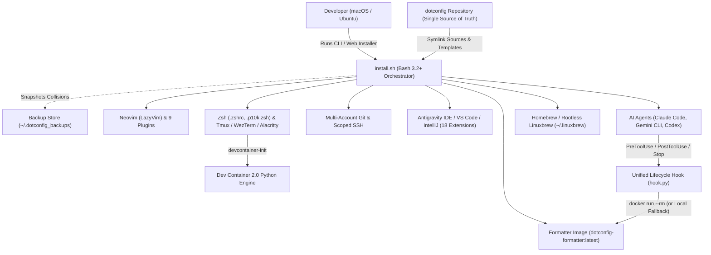
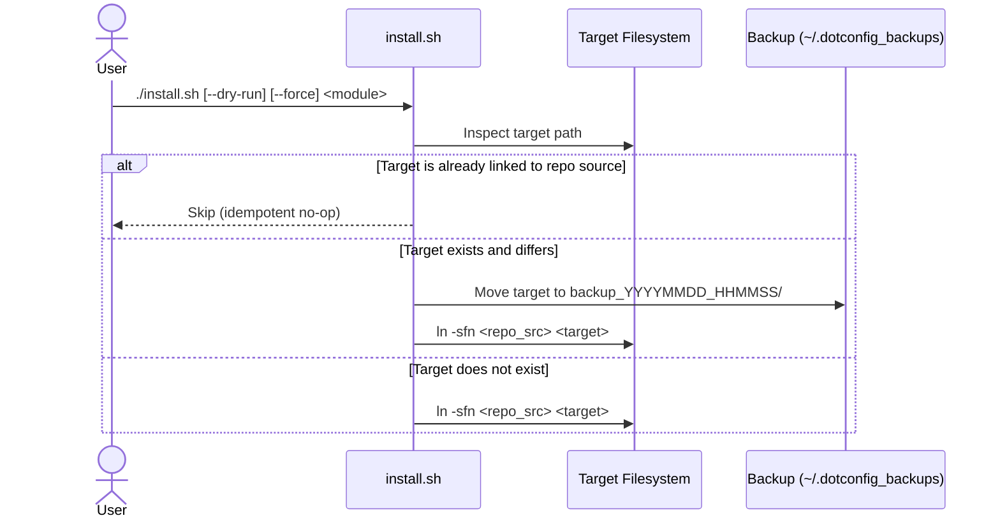
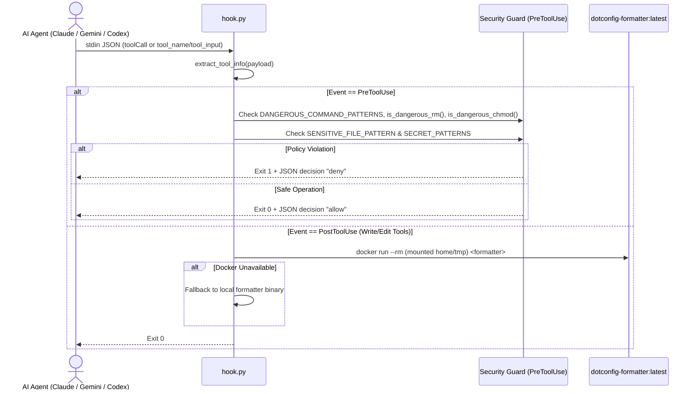
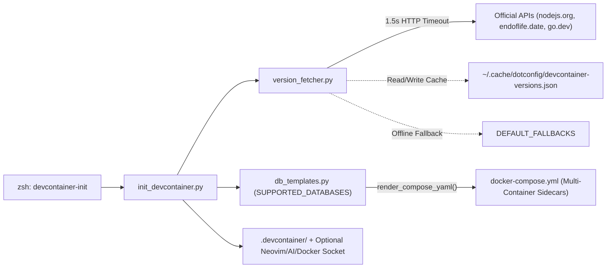

**English** | [한국어](./ARCHITECTURE.ko.md)

# Dotconfig Architecture Guide

This document describes the system architecture, runtime workflows, module internals, and **Architecture Decision Records (ADRs)** behind `dotconfig`.

---

## 1. System Context & Container Architecture (C4 Model)

`dotconfig` acts as a declarative **Single Source of Truth (SSoT)** for macOS and Ubuntu Linux workstations (including rootless cluster environments). An idempotent Bash orchestrator projects repository assets into target user paths via symbolic links without leaving untracked mutations on the host.

---

## 2. Core Runtime Workflows

### 2.1 Idempotent Deployment & Safe Backup Flow

Before creating or updating a symlink, `install.sh` supports `--dry-run` simulation and automatically archives existing non-matching files into timestamped backup folders.

### 2.2 Cross-Platform AI Agent Lifecycle Hook (`hook.py`)

`agents/shared/hooks/hook.py` normalizes JSON payloads across Claude Code, Gemini CLI / Antigravity, and Codex into a single security and formatting pipeline.

### 2.3 Dev Container 2.0 Dynamic Generation (`devcontainer-init`)

Invoked from `zsh/.zshrc` with native tab completion (`_devcontainer_init_completion`), `init_devcontainer.py` resolves templates, live runtime versions, and optional database sidecars without third-party Python dependencies.

---

## 3. Module Architecture Breakdown

### 3.1 Installer & Package Management (`install.sh`, `Brewfile`)
- **Bash 3.2+ Compatibility**: Avoids associative arrays and Bash 4+ extensions so fresh macOS systems execute `./install.sh` out of the box with `set -euo pipefail`.
- **Web Bootstrap**: When executed remotely (`DOTCONFIG_DIR` defaults to `~/.dotconfig`, cloning `https://github.com/gdtknight/dotconfig.git`), it clones/updates the repo and runs the default `all` bundle (`packages`, `nvim`, `agents`, `ide`, `git`, `zsh`, `terminal`, including `fonts`) or any explicitly passed modules (`formatter` is built separately via `./install.sh formatter`).
- **Rootless & OS Isolation**: `Brewfile` wraps macOS GUI casks (`google-chrome`, `alfred`, `rectangle`, `orbstack`, `wezterm`), `terminal-notifier`, and Nerd Fonts inside `if OS.mac?`, keeping CLI tools (`neovim`, `tmux`, `eza`, `zoxide`, `fzf`, `ripgrep`, `bat`, `lazygit`, `gh`) clean for `~/.linuxbrew`.

### 3.2 Multi-Vendor AI Agent Synchronization (`agents/`)
- **Unified Prompt & Skill Tree**: `agents/shared/` maintains global `INSTRUCTIONS.md`, `rules/`, `13` specialized subagent definitions under `agents/shared/agents/*.md` (paired with `agents/codex/agents/*.toml`), shared multi-file skill directories under `agents/shared/skills/<name>/` (such as `graphify`), and canonical MCP definitions in `agents/shared/mcp.json`.
- **Workload Model Tiering**: Deep-reasoning subagents (`8` review/architecture/debug/refactor/comprehensive-test/writing agents) and fast-execution subagents (`5` unit/integration/git/docs agents) align across Claude (`opus`/`sonnet`), Codex (`model_reasoning_effort` `high`/`medium`), and Antigravity (`INSTRUCTIONS.md` routing to `pro`/`flash`).
- **Platform Adapter & Cross-Vendor MCP Sync**: `install.sh agents` runs `agents/shared/sync_mcp.py` to render `agents/shared/mcp.json` into Gemini/Antigravity (`agents/gemini/mcp_config.json`, `serverUrl`), Codex (`agents/codex/config.toml` `[mcp_servers.*]` TOML block), and Claude Code (`~/.claude.json` `mcpServers` merge without touching dynamic state), then links assets into `~/.claude/`, `~/.gemini/`, and `~/.codex/` and bootstraps CLI binaries (`agy`, `claude`, `codex`).
- **Security & Formatting Guard (`hook.py`)**:
  - `PreToolUse` (`handle_pre_tool()`): Inspects shell commands (`git push --force`, `git reset --hard`, `git clean -f`, `mkfs`, `dd`), root/home `rm` targets (`is_dangerous_rm()`), recursive `777` permissions (`is_dangerous_chmod()`), and secret file/API-key leakage (`SENSITIVE_FILE_PATTERN`, `SECRET_PATTERNS`).
  - `PostToolUse` (`handle_post_tool()`): Maps extensions (`.js`, `.ts`, `.py`, `.c`, `.cpp`, `.lua`, `.java`, etc.) to `prettier`, `ruff`, `clang-format`, `stylua`, and `google-java-format` inside `dotconfig-formatter:latest`, falling back to host binaries if Docker is unavailable.

### 3.3 IDE, Quota Isolation & Compatibility Patching (`ide/`, `nvim/`)
- **Neovim (LazyVim)**: Symlinks `nvim/` to `~/.config/nvim`, providing `9` focused plugin configurations (`42format.lua`, `42header.lua`, `bufferline.lua`, `devcontainer.nvim.lua`, `emoji-picker.nvim.lua`, `markview.nvim.lua`, `obsidian.nvim.lua`, `tokyonight-nvim.lua`, `vim-tmux-navigator.lua`).
- **Quota-Safe Storage (`~/goinfre`)**: `setup_goinfre_symlink` detects `~/goinfre` on quota-restricted cluster workstations and relocates `.vscode/extensions`, `.antigravity-ide/extensions` (in `link_ide`), as well as `~/.linuxbrew` and `~/.cache/Homebrew` on Linux (in `install_packages`), preserving dotfiles and internal symlinks cleanly.
- **Antigravity IDE Dev Container Compatibility Patch**: `patch_antigravity_dev_containers` patches container status checks (`"start"===(i.status||i.Status)` -> adds `||i.Action`) for reliable container lifecycle detection across CLI versions.
- **Declarative Extensions**: Tracks `18` curated extensions in `ide/antigravity-ide/extensions.txt`, refreshable via `./install.sh --dump-extensions`.

### 3.4 Dev Container 2.0 Engine (`devcontainers/`)
- **9 Templates**: `42-c-valgrind`, `devops-cloud`, `fullstack-db`, `go-backend`, `java`, `node-ts`, `python-ai`, `react-native`, and `rust`.
- **Smart Version Resolution (`version_fetcher.py`)**: Queries official endpoints (`nodejs.org/dist/index.json`, `endoflife.date/api/python.json`, `go.dev/dl/?mode=json`) with a strict `1.5s` timeout (`TIMEOUT_SECONDS = 1.5`), caching responses in `~/.cache/dotconfig/devcontainer-versions.json` and degrading gracefully to `DEFAULT_FALLBACKS`.
- **Automatic Sidecar Promotion (`db_templates.py`)**: Selecting any database in `SUPPORTED_DATABASES` (`postgres`, `redis`, `mysql`, `mongo`) automatically upgrades a single-container template into a multi-service `docker-compose.yml` via `render_compose_yaml()` with persistent named volumes.

### 3.5 Shell, Fonts & Multi-Account Git (`zsh/`, `alacritty/`, `wezterm/`, `tmux/`, `git/`)
- **Deterministic Shell Startup (`zsh/.zshrc`)**: Deduplicates `PATH`/`FPATH` with `typeset -U`, initializes Homebrew `shellenv` *before* Oh My Zsh, prioritizes installed `nvim` as `EDITOR` even over SSH, verifies `__p9k_sourced` fallback loading, and resolves the repo path dynamically via `_dotconfig_repo_dir()`.
- **Multi-Account Git**: `setup_git_accounts` generates `~/.config/dotconfig/git-accounts.env`, per-account `~/.gitconfig-<user>`, and `~/.gitconfig.local`, scoping `sshCommand` strictly to account contexts.
- **Terminal & Fonts**: Auto-bootstraps TPM + installs Tmux plugins on `install.sh terminal` and registers D2Coding / ComicShannsMono Nerd Fonts via CoreText on macOS.

---

## 4. Architecture Decision Records (ADRs)

### ADR-01: Bash 3.2+ Monolithic Orchestrator Instead of GNU Stow or Chezmoi
- **Context**: Target workstations include fresh macOS machines (default Bash 3.2, no preinstalled package managers) and locked-down Linux cluster nodes without `sudo`.
- **Decision**: Implement `install.sh` in pure POSIX/Bash 3.2+ with zero external tool prerequisites.
- **Consequences**: Web one-liner installation works on clean machines before Homebrew exists, with explicit backup semantics (`~/.dotconfig_backups`) and `--dry-run` safety, at the cost of maintaining link functions manually in Bash.

### ADR-02: Shared Single Source of Truth + Payload Normalization for 3 AI Agents
- **Context**: Claude Code, Gemini CLI, and Codex CLI expect different directory structures and hook JSON payload keys (`toolCall` vs. `tool_name` / `tool_input`).
- **Decision**: Maintain one canonical rule/agent tree under `agents/shared/` mapped by `install.sh agents`, and unify hook handling in `agents/shared/hooks/hook.py` via `extract_tool_info()`.
- **Consequences**: Security guardrails and engineering rules stay 100% consistent across all three vendors with zero duplicate prompt maintenance.

### ADR-03: Ephemeral Containerized Formatter (`dotconfig-formatter:latest`)
- **Context**: Auto-formatting files across C/C++, Java, Lua, Python, and JS/TS via host tools requires polluting global environments with mismatched Node/JDK/LLVM toolchains.
- **Decision**: Package all formatters (`clang-format`, `google-java-format` v1.24.0, `prettier`, `ruff`, `black`, `stylua`) in `docker/formatter/Dockerfile` (`debian:bookworm-slim`) and run ephemeral `docker run --rm` invocations in `PostToolUse`, with local binary fallback.
- **Consequences**: Reproducible formatting across macOS and Ubuntu without host dependency conflicts, while remaining usable when Docker is stopped.

### ADR-04: Zero-Dependency Python Dev Container Generator with Bounded 1.5s Timeout
- **Context**: Interactive Dev Container scaffolding runs inside developer shells across corporate/campus networks where external package installs are friction and offline/slow networks occur.
- **Decision**: Build `init_devcontainer.py`, `version_fetcher.py`, and `db_templates.py` using only Python standard library modules (`urllib.request`, `json`) with `TIMEOUT_SECONDS = 1.5`, local caching, and static `DEFAULT_FALLBACKS`.
- **Consequences**: Near-instant CLI UX online and deterministic offline behavior without requiring a virtualenv.

### ADR-05: Symlink Relocation (`~/goinfre`) & Rootless Linuxbrew Isolation
- **Context**: Academic/enterprise cluster environments enforce strict home-directory disk quotas and disallow `sudo` package installation.
- **Decision**: Automatically detect `~/goinfre` to symlink-relocate heavy IDE extensions (`link_ide`) plus `~/.linuxbrew` and `~/.cache/Homebrew` on Linux (`install_packages`), while gating macOS GUI casks inside `if OS.mac?` in `Brewfile`.
- **Consequences**: Identical developer tooling on both personal macOS laptops and quota-limited Ubuntu cluster hosts without exhausting home NFS quotas.
